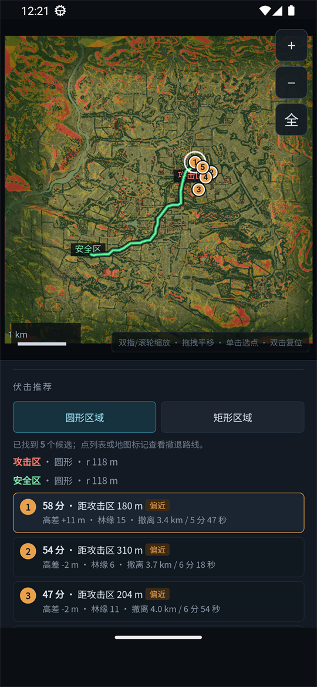
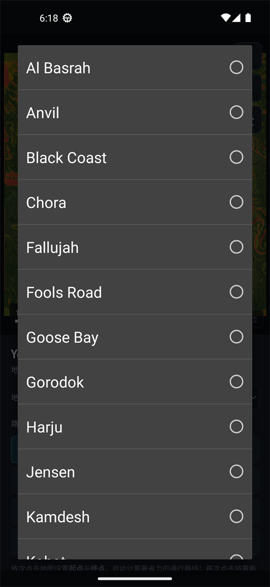
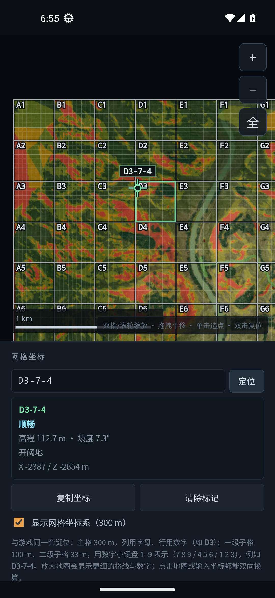

# Squad 载具通行 · Yehorivka Passability

Squad（50v50 战术射击）的**离线载具通行与战术地形分析** Android App：把 25 张官方地图的
高程、坡度、树冠、建筑、围墙、道路、水域、桥梁栅格化，在手机上算路线、可达区、视线、
伏击点、架枪位与网格坐标。

纯本地计算：**没有 INTERNET 权限，一张地图一页 HTML，全部数据打进 APK**。

* Android 7.0+（minSdk 26）· targetSdk 35 · 版本 0.15.0
* 单页 Canvas 引擎 + WebView 壳；同一份 HTML 也是桌面版，可直接用浏览器打开
* 25 张官方地图（Yehorivka、Al Basrah、Narva、Gorodok、Skorpo、Logar …）



## 功能

| 模块 | 说明 |
|---|---|
| 路线规划 | 起点 / 终点，A*，路线长度、累计爬升、最大坡度、顺畅比例、ETA |
| 可达区 | 从一点出发、不越坡不穿林能到达的连通区域 |
| 查询 | 点地图看高程 / 坡度 / 树冠 / 世界坐标；浮卡同时给出游戏网格坐标 |
| 网格坐标 | 与游戏相同的 300 m 主格（A–V / 1–22）+ 100 m + 33 m 子格，可点图取值、输坐标定位 |
| 禁区 | 圆形 / 矩形，矩形可 ±15° 旋转或滑杆微调 |
| 伏击推荐 | 攻击区 + 安全区 → 按距离、视线、林缘、高程评分给出最多 5 个伏击点与撤退路线 |
| 区域入口 · 架枪位 | 圈区域 → 识别边界缺口 A–F，每个入口推荐最多 3 个有射界的架枪位，武器有效射程 50–2000 m |
| 最近隐蔽点 | 100–1200 m 半径内按树冠/房屋/低洼度选最近的隐蔽点 |
| 隐蔽推进 · 沿线射界 | 集结点 → 区域，按隐蔽度加权 A* 算进入路线，并推荐沿线威胁架枪位 T1–T5 |
| 区域分区 · 观察点 | 圈区域 → 分成最多 5 块，每块 2–5 个隐蔽观察点并算联合覆盖率 |
| 载具类别 | 陆地 / 两栖 / 水面舰艇 / 直升机；直升机另算平坦无林着陆地 A–E |
| 地形视线 | 2 km 内三色着色（地面可见 / 仅人物高度可见 / 遮挡），可叠加树林、建筑、围墙硬遮挡 |
| 图层与统计 | 底图、通行性着色、围墙、1 km 网格、300 m 网格坐标系、图例、面积统计 |




更细的功能说明、算法口径和逐版本验证记录见 [android/README.md](android/README.md)。

## 下载

Release 里附了构建好的 APK（0.15.0，release 构建但用 **debug keystore** 签名，方便侧载，
不是 Play 商店签名）：

<https://github.com/copperbookworm/Yehorivka-Passability/releases/latest>

也可以自己构建，见下一节。

## 从源码构建

需要 **JDK 17** 和 **Android SDK 35**（命令行构建时设置 `JAVA_HOME` / `ANDROID_HOME`，
或写进 `android/YehorivkaMap/local.properties` 的 `sdk.dir`）。仓库自带 Gradle Wrapper。

```bash
cd android/YehorivkaMap
./gradlew assembleRelease        # macOS / Linux
gradlew.bat assembleRelease      # Windows
```

产物：`android/YehorivkaMap/app/build/outputs/apk/release/app-release.apk`。

也可以直接用 Android Studio 打开 `android/YehorivkaMap`，Run / Build APK。

安装到手机：

```bash
adb install -r app-release.apk
```

## 重新生成地图页

仓库里已经包含生成好的 25 张地图页（`android/YehorivkaMap/app/src/main/assets/maps/*.html`），
所以**不改地图页就不需要跑生成器**。改了根目录模板
`yehorivka-vehicle-passability.html` 后：

```bash
python -m pip install pillow numpy
python tools/download_maps.py     # 下载 heightmap / basemap / topomap / 3D 实例到 .tmp/maps_source
python tools/build_maps.py        # 生成 25 页；只重生一张：--only narva
```

生成器做的事：解码高程 → 坡度/水域 → 底图 JPEG → 道路掩膜 → 3D 树/建筑/围墙栅格化 →
把六张数据图以 base64 内联进模板，输出单文件地图页。

## 手动标注器

自动识别水体不准时，用桌面标注器补画（tkinter + Pillow）：

```bash
python tools/annotate_maps.py       # 或双击 start-map-annotator.bat
```

图层：水域、桥梁、地图边界内、通畅道路、不可通行障碍、水面舰艇航道。
标注写到 `annotations/<slug>/*.png`（2048×2048），生成器会下采样到 1024 优先使用。


## 目录结构

```
yehorivka-vehicle-passability.html      单页地图引擎（桌面版 + 生成器的模板）
tools/
  maps_catalog.json                     25 张官方图的名称 / 边界 / 高度缩放
  download_maps.py                      下载 SquadCalc 的地图源数据
  build_maps.py                         生成每张地图的 HTML 页
  annotate_maps.py                      桌面水体 / 桥梁标注器
  sync_mobile_html.py                   兼容入口，直接调用 build_maps.py
  check_mobile_html.py                  开发期自检脚本
annotations/<slug>/*.png                手动标注掩膜（water/bridge/boundary/clear/obstacle/boat）
android/YehorivkaMap/
  app/src/main/java/.../MainActivity.java   WebView 壳
  app/src/main/res/                       图标 / 布局 / 主题
  app/src/main/assets/maps/*.html         25 张地图页（生成产物，已入库）
android/README.md                       功能、算法、逐版本验证记录
docs/                                   README 截图
```

## 数据与算法

* 每张图 1024×1024 栅格：高程、坡度、树冠覆盖、建筑、围墙、道路、水域、桥梁、边界、
  通畅道路、障碍、舰艇航道；
* 通行判定顺序：边界外 / 禁区 → 桥面（绝对可通行）→ 水域（陆地载具硬障碍）→
  建筑、围墙、密林 → 坡度上限；道路与硬地按豁免规则放行；
* 路线是栅格 A*，代价含距离、坡度、林冠；可达区是同一次搜索的连通域；
* 地形视线从观察点眼高按 4096 个方位维护“最大地形仰角”，可选把密林、建筑、围墙当硬遮挡；
* 网格坐标原点就是图左上角，列沿 X 增长、行沿 Z 增长，与 SquadCalc 的 `getKP()` 定义一致。

## 已知限制

* 水体 / 桥梁 / 树林都是栅格近似，不等于游戏内逐件模型的精确判定；
* 自动水体识别只认 topomap 里足够暗的深水，浅滩、可涉水河段不会自动标成障碍，需要手工标注；
* 目前只打包 25 张官方地图，SquadCalc 的 MOD 地图（SuperMod / Global Conflict）是独立 mod 内容，未包含；
* release 构建用 debug keystore 签名，仅供个人侧载。

## English

An offline Android app for *Squad* that turns the 25 official maps into 1024×1024
terrain grids (elevation, slope, canopy, buildings, walls, roads, water, bridges)
and runs route planning (A*), reachability, line-of-sight, ambush/overwatch
recommendations and in-game grid coordinates on the device. No network permission,
no third-party runtime dependencies on the phone: the Android shell is a plain
`WebView` around one self-contained HTML page per map.

Build with JDK 17 + Android SDK 35 using the bundled Gradle wrapper, or open
`android/YehorivkaMap` in Android Studio.

## 许可证

[MIT](LICENSE) © 2026 copperbookworm

地图素材、Squad 游戏资产与 SquadCalc 数据的版权归各自所有者，MIT 只覆盖本仓库的代码，
详见 [NOTICE.md](NOTICE.md)。

本项目是非官方粉丝工具，与 Offworld Industries 无关。
