# Squad 载具通行 · Android（25 张官方地图）

把桌面版 **yehorivka-vehicle-passability.html** 原样移植到手机：
同一套底图 / 坡度 / 高程 / 树冠 / 道路 / 围墙数据与 A* 算法；
外面套一个离线 WebView 壳，界面改成手机布局（竖屏地图在上、面板在下；横屏面板在右）。

0.6.0 起接入 SquadCalc 的 **25 张官方地图**：标题下方“地图”下拉切换，返回键回上一张。
0.7.0 起加入 **海洋/深水河不可通行、桥梁绝对可通行、起点/终点避水**。
0.7.1 起 **坡度上限滑杆最大 60°**（最小 3°）。
0.8.0 起支持手动边界 / 通畅道路 / 障碍，以及仅舰艇使用的航道预设。
0.9.0 起加入测距：起点到目标点的水平距离、高差、空间直线距离（米）。
0.10.0 起加入 **陆地 / 两栖 / 水面舰艇 / 直升机** 四种载具类别，以及直升机着陆地候选区。
0.11.0 起加入 **区域入口识别与架枪位推荐**；0.12.0 起加入 **最近隐蔽点搜索**；
0.13.0 起加入 **隐蔽推进路线与沿线威胁射界**；0.14.0 起加入 **区域分区与隐蔽观察点**、
**架枪位武器有效射程 50–2000 m**；0.15.0 起加入 **与游戏同款的网格坐标系**（归在“查询”模块里）。
0.16.0 起加入 **敌情标记 · 图标**：112 个 Squad 官方兵种 / 载具 / 工事图标可贴到地图上标敌人位置，
按地图自动保存，可复制成文字坐标清单；0.16.1 把标记缩到原来的 **1/4**（4–9 px），不再挡住地图细节；
0.16.2 起图标改为**按 SVG 路径用 Canvas Path2D 现场矢量绘制**（不再用位图），任意尺寸和屏幕像素密度下都清晰，
标记随地图缩放变大也不会糊；选择器缩略图同样是矢量。0.16.3 修掉矢量绘制的图层抵消问题——
同色 path 合并成一条 `Path2D` 时，重叠且绕向相反的子路径按 nonzero 互相抵消，步兵头盔被“挖空”只剩深色轮廓（看起来是黑头盔）；
改为**每个 path 单独成层绘制**后 112 个图标全部正常。
0.17.0 起加入 **自由路线 · 标注**（手绘折线、10 种颜色、可在线上任意点写备注，画线时自动固定地图）
与 **存档 · 导出 / 导入**（把标记与路线存成本机存档、导出 `.json` 分享到 QQ / 微信、从文件导入继续编辑）。
0.18.0 起 **10 个分析工具的结果自动保存**：路线 / 可达区 / 查询 / 伏击推荐 / 区域入口 · 架枪位 /
最近隐蔽点 / 隐蔽推进 · 沿线射界 / 区域分区 · 观察点 / 通视分析 / 测距 的结果按地图存到本机，
并随存档一起导出 / 导入；面板上有 `N / 10 项` 计数与「清除本图分析结果」。
0.19.0 起敌情标记分成 **新建 / 选择** 两档：**新建** = 选图标后点地图放置；**选择** = 点中已放置的标记后
可**按住拖动改位置**、可**旋转角度**（滑杆 0–359°，或 ±15° 微调；选中时有一条蓝线指示当前朝向），
角度随标记一起存本机、随存档导出 / 导入；图标选择器里移除了 **FOB（蓝）** 与 **HAB（激活）** 两个图标，
其余 110 个（步兵 6 / 载具 89 / 工事 15）不变。
0.20.0 把敌情标记**画在所有其他模块之上**（路线、可达区、测距、视线等标记都不会再压住它）；
标记可以在“选择”模式下加 **状态**（健康 / 受损 / 阵亡（步兵）· 摧毁（载具、工事），受损可写备注，可改可删），
还可以从一个标记**放多条箭头**（起点固定在该标记、终点点地图定，8 种颜色，可改终点、可删除）。
0.21.0 给每个标记加 **自定义标签**（具体型号 / 呼号，如 `BTR-82A`，标签与“受损”备注都会显示在地图上），
给箭头放置加 **操作提示**（悬停虚线预览 + 提示文案 + Esc 取消），**自由路线每一段自动带方向箭头**，
存档里写明**所属地图**并支持**导入时自动切到那张图**，界面左上显示 **当前版本号 `v0.21.0`**。
0.22.0 起加入 **区域标注 · 圆形 / 矩形**：在地图上画圆或矩形并**给区域命名**，名字直接画在区域中心，
按地图自动保存，随存档导出 / 导入。
0.23.0 面板第一个选项变成 **角色**：选 **载具乘员** 或 **步兵**。通用模块（查询、通视分析、测距、敌情标记、
自由路线、区域标注、存档、伏击推荐）统一**置顶**；载具乘员额外显示 **路线 / 可达区** 与载具参数（类别 / 坡度 /
密林阈值），步兵显示 **区域入口 · 架枪位 / 最近隐蔽点 / 隐蔽推进 / 区域分区**，另一组自动隐藏。角色选择存本机，
重开保持；当前模式被新角色隐藏时自动回落到「查询」。
0.24.0 把**存档升级成一套文件系统**：「文件」栏挪到**地图选项上方**，四个按钮 **新建 / 打开 / 保存 / 另存为**
（外加导出分享、从文件导入），像 Word 一样有「当前文件」的概念。每个模块都有自己的 **清除 / 撤销 / 重做**，
顶部另有 **全部清除** 与全局撤销 / 重做；区域标注的**矩形可以旋转角度**（±15° 或 0–359° 滑杆）。
0.25.0 让**区域颜色也能改**：选中区域后从 10 种颜色里点一个，或用自己的取色器选任意颜色，也能一键还原默认色；
颜色随区域存本机、随存档导出 / 导入。
0.26.0 **删掉了「双击地图复位」**：以前双击地图会跳回全图，手快连点两下就把正在看的局部视野弄丢；
现在复位只走右上角 **`全`** 按钮，提示条也改成「点「全」复位」。
0.27.0 起加入 **载具火力支援**：依次点 **步兵队位置 → 打击区域（圆 / 矩形，可旋转）→ 支援载具型号**，
程序自己算 **阵位、进场起点、退场终点、三段路线和每一段的时间**（进场 → 展开校射 → 火力打击 → 撤离），
面板给一张逐时刻的时间轴；直瞄武器按视线覆盖挑阵位，够不到就自动改用 **曲射免通视** 或 **概略坐标压制射击**，
并在面板上写清楚是哪种。109 台可支援载具（主战坦克 / IFV / 装甲车 / 自行火炮 / 火箭炮 / 迫击炮 / 反坦克导弹车等）
按车型分组可选，武器与射程窗口取自 Squad 载具数据。
0.28.0 把**危险区**和**武器**接进火力支援：依次点 **步兵队位置 → 打击区 → 危险区 → 载具型号 → 使用武器**，
路线只在**危险区里**走，算出来的就是 **进入危险区的起点 / 退出危险区的终点 / 逐段路线 / 每段用时**，
时间直接标在地图的进、退点与射击段旁边。武器可单独选（同一台车的主炮 / 机炮 / 机枪 / 反坦克导弹射程窗口不同）；
**机枪、重机枪、机炮、榴弹发射器没有保险距离**，可以让载具贴近甚至开进打击区**边跑边打、不停车**
（「近战直射」方案：射击时间就是路线落在射程内那一段的行车时间，没有展开与校射），
面板另有「自动 / 远距阵位 / 近战直射」三挡可手动指定。
0.29.0 把 **密林郁闭度** 收回到只有载具的「**路线 / 可达区**」用：面板上的密林阈值与通行性着色仍按
25 m 窗口的树冠覆盖率算；**其余模块**（入口 / 隐蔽点 / 隐蔽推进 / 区域分区 / 伏击 / 直升机 / 视线 / 火力支援）
改看 **每格树的棵数** —— ≥1 棵/格算有树（林缘、草丛），≥2 棵/格算密林（挡车、也能藏人），界面统一写「树 N 棵/格」。
同一片林子按棵数算比按郁闭度算宽松，所以这些模块现在更愿意把树多的地方当可用掩蔽，而路线依旧保守。
0.30.0 新增 **旗点 · 占领区** 开关：打开后在地图上画出本图 **AAS / RAAS / Invasion** 的全部旗点 ——
**占领区轮廓**（圆 / 矩形 / 胶囊，按 Squad 的真实占领区几何与朝向换算）、**序号**（主基地标「主」）、
**旗点名 + 中文译名**。面板可选图层（6 个模式版本）、RAAS 还能切 **进攻链**（Alpha…），
可分别开关 占领区 / 中文名 / 英文名 / 序号；点列表里的旗点或直接点地图上的旗点即选中并把地图居中。
数据来自 squadcalc.app 的图层接口（25 张图的 127 个图层、3360 个旗点全部内置进页面，运行时不联网）。
0.31.0 把 RAAS 的显示改成 **默认画出所有进攻链的点位**：五条（AlBasrah 到八条）链的候选点并在一起，
**同一处占领区只画一次**，被几条链共用就在名字下方列出（如「A2 / B1 / C1」，徽标字母就是链号，A…H 各有颜色）；
面板顶部显示「43 处 · 62 个链位」，想看某一局的实际顺序再从下拉里选单条链，链内备选点仍用 a / b 区分。
主基地标「主」，没有被任何进攻链引用的孤立点位不画。

0.32.0 新增 **等高线地形图**：面板「图层」里勾上就**把卫星底图换成地形图**（地图右上角的 **`线`** 按钮也能一键切换，
手机上就在放大 / 缩小 / 复位那排按钮里）。地形图按海拔上色（绿低 → 黄 → 棕高）、带山体阴影与细等高线，
覆盖范围与卫星图完全对齐（同一条河、同一条跑道、同一处聚落都对得上），比例尺、网格、路线、旗点、火力支援路线
照样叠在上面看。切到地形图时会**自动关掉「通行性着色」**（整片绿 / 红会把地形盖住），切回来自动还原；
选择按地图记住（`sqtopo:<地图>`），下次打开还是地形图。25 张图的地形图全部内置进页面，运行时不联网。

0.33.0 给界面上的**按钮都配了图标**：模块网格（查询 / 通视分析 / 测距 / 敌情标记 / 自由路线 / 区域标注 /
伏击推荐 / 载具火力支援 / 旗点）、新建打开保存另存为与存档行、角色、载具类别、坡度预设、图层与缩放、
每个模块标题旁的清除 / 撤销 / 重做，以及地图上选中对象后弹出的行内按钮（改名 / 删除 / 移动端点）都多了一个小图标。
图标是**自绘的内联 SVG**，跟着按钮文字的颜色走（按钮变青色高亮时图标一起变），不加载字体、不联网；
地图右上角那排缩放按钮里的 `+ / − / 全 / 线` 干脆只留图标（仍带无障碍名称）。

0.34.0 三件事：
（1）把「地形视线（2 km）」改名为 **「通视分析（2 km）」**（面板按钮、标题、提示、清除按钮、撤销历史与分析结果清单里的名字一起改，功能不变）。
（2）**导出 / 分享的文件名改成你自己填的**：上面「文件名」框里写什么，导出的 .json 就叫什么（不再自动拼成
`goosebay-20261023-1122.json`）；名字里的 / : * ? " < > | 会换成下划线，**不填名字就不导出**并提示先填名字。
（3）新增 **沿线通视 · 并集 / 交集**：在地图上依次点出一条路线，程序按 **采样间距** 沿路线取采样点，
算出每个采样点的通视范围，再把它们叠起来——**青色**=至少一个采样点能看到（并集），
**绿色**=每个采样点都能看到（交集）；面板给出并集 / 交集面积与占并集的比例、单点平均面积、计算耗时，
采样间距 / 分析半径 / 观察高度三个滑杆随改随算，另有「撤销上一点」与「清除路线」，结果随存档与分析结果一起保存。

0.35.0 五件事：
（1）**敌情标记图标扩到 352 个**：新增 Squad 官方 **兵种图标 23 个**（步枪兵 / 自动步枪兵 / 医疗兵 / 班长 /
载具组员 / 飞行员 / 狙击手 / 工兵 / 侦察兵 / 新兵 / 专家 …）与 **武器图标 218 个**（ak74 / M4 / 各类配件组合），
原有的 110 个不变；图标网格上方多了 **搜索框**（输「坦克」「ak」「医疗」即时过滤），类别多一栏 **武器**，
重名的新图标自动改名（如 `rallypoint` → `rallypoint-2`）。
（2）新图标是 **SVG 矢量文件**（`assets/icons/squad/*.svg`），按 **原始宽高比** 画：武器图标是 2:1 的横长剪影，
贴到地图上不会被压成方块，网格缩略图与列表小图也都按比例显示。
（3）新增 **官方载具名** 选择器：选中一个载具图标后，面板出现「官方名称」一栏，从 **424 条 Squad 官方载具名** 里
**点一下就把名字写进标记标签**（自动同步到上面的标签输入框）；可按 **阵营**（20 个：美国陆军 / 俄罗斯陆军 /
中国陆军 / 民兵 / 假想敌 …）与 **类别**（16 个：主战坦克 / 步兵战车 / 装甲运兵车 / 运输卡车 / 后勤卡车 /
武装直升机 / 自行火炮 …）**两级筛选**，另有 **名称搜索**（输 BTR / T-72 / 直升机）和 **按此图标筛**
（只看与当前图标同型的车）；同一个名字在多个阵营都有时只列一次，共 **234 个不同名称**。
（4）标签上限 24 → **32 字**，够写 `T-72B3 2016` 这类长型号。
（5）新增 **WebP → SVG 转换器**（`icons/edit_app/webp2svg`）：纯 Python，Pillow + numpy + potracer，
自动区分「平面剪影（真描摹成 path）」与「照片（内嵌位图）」，批量 / 递归 / 并行 / 出 JSON 报告；
`squad-armor/icons` 下 379 个 webp 转出 **345 个 SVG**（其余 34 个源文件本身是站点 404 的 HTML 兜底页）。

0.38.0 改**区域标注的操作顺序**：先给区域**起名**，再决定**形状** —— 面板里名字输入框挪到形状按钮上面，
名字点「应用名称」确认后 **圆形 / 矩形** 才解锁；没起名时两个形状按钮是灰的、点地图也不会新建区域（只提示先起名）。
名字画一次就用掉（输入框清空、按钮重新锁上），接着画下一个要重新起名；选中某一行后**再点这一行**可取消选中，
回去给新区域起名。

0.39.0 把**地图数据搬上 GitHub**：25 张图的底图 / 高程 / 坡度 / 树冠 / 障碍 / 旗点打包成 25 个
`.json` 数据包（约 63 MB）放在公开仓库
[copperbookworm/Yehorivka-MapData](https://github.com/copperbookworm/Yehorivka-MapData)，
App 里多了「地图数据 · 在线更新」面板，可以**手动检查 / 下载 / 删除**，下完立刻生效，**不用重装 APK**。
装包里仍自带一份完整数据，没网照常用。

0.40.0 在「敌情标记」面板顶上加了 **主基地部队编成**：选 **阵营**（17 个）→ **对局类型**
（大图 · 进攻方 / 大图 · 防守方 / 中图 · 进攻方 / 中图 · 防守方 / 小图 / 小图 · 遭遇战 / 小图 · 种子局）→
**具体部队**（如 1st Infantry Division、504th Parachute Infantry Regiment、第 78 独立补给旅），
一次列出该部队的 **载具装备**（数量、**首次可用延迟**「开局」绿标或「延迟 N 分」、重生时间、票值、座位、
车型）、**人员配置**（每个兵种的名额上限与变体数）、**可用工事**（建造点、FOB 数量上限、类别）、
**火力支援 · 指挥官技能**（冷却 / 呼叫到命中 / 持续），底部有「复制该部队编成（文本）」。
数据是从 Squad 10.6 游戏文件里导出的 **267 个可玩编制**：载具数量 / 延迟 / 重生取自每张 layer 的
单位载具表（所以同一部队在大图进攻、大图防守下的编成不同），人员名额、工事、指挥官技能取自
faction setup 的编制表；选择结果按本机记住，重开保持。

0.41.0 让「主基地部队编成」**自己判断该选大图 / 中图 / 小图**：面板不再要你猜对局类型，
它去读「旗点 · 占领区」里当前选中的那一局（如 `Yehorivka_Invasion_v1`），按这局的编制档自动选中
**大图 · 进攻方 / 大图 · 防守方 / 中图 · 进攻方 / 中图 · 防守方 / 小图**，切换旗点图层时编成面板立刻跟着变
（例：Yehorivka 从 AAS_v2 切到 Invasion_v1，编制仍是 LO 进攻方；Harju 的 AAS_v1 是大图、AAS_v2 是中图，跟着换）。
判定依据是 **196 个图层** 的部队编成后缀（`_LO_` / `_LD_` / `_MO_` / `_MD_` / `_S_`，`_Skirmish` / `_Seed` 单独标注），
**只有 Invasion 的大图 / 中图才分进攻方与防守方**（AAS、RAAS 两队编成相同，忽略攻守偏好）。
提示行会写明来源与结果，右侧有 **关闭跟随 / 恢复跟随** 链接：手动换过对局类型就自动转成手动模式
（提示行显示「手动「小图」」），点「恢复跟随」再回到自动。没有旗点数据的图（Jensen）提示
「本图无旗点数据 · 无法自动判定对局规模」，手动选即可。跟随开关与攻守偏好按本机记住。


0.42.0 在「查询」面板给标记点加了一个 **坡度小箭头**：琥珀色箭头以十字标记为起点，指向**高程下降最快
（下坡最陡）的方向**，带深色描边，橄榄绿底图、等高线地形图、坡度热力图上都看得清；箭头长度固定 30 px，
不随缩放变大变小。旁边的网格坐标标签会自动躲开箭头（箭头朝上时标签改画到标记点下方），不再压住箭头。
方向用「以标记点为中心、**±4 格（约 ±25 m）窗口内的高程平面拟合**」取负梯度算 —— 高程本身是分级的
（台阶状），单格相邻差值会左右乱跳，平面拟合给出的是这一小片地形的平均朝向。
「网格坐标」里新增开关 **显示坡度箭头（指向下坡最快方向）**，默认打开，关掉只留十字标记与读数；
开关按地图各自记住，重开保持。注意箭头只表示**地形朝向**，能不能过仍由下方「地面载具坡度上限」决定。

0.43.0 把 **查询** 与 **测距** 挪到地图右侧，跟放大 / 缩小 / 复位 / 等高线那排按钮同类：竖排 40×40 圆角按钮，
放大键下面多一条分隔线，再下面是 **查询（准星图标）** 与 **测距（尺子图标）**；点中时和模块按钮一样高亮（青边）。
规则同放大键：手机 / 触屏布局才显示（`@media (max-width:880px),(pointer:coarse)`），桌面宽屏仍走左侧面板。

点右侧 **查询** 直接弹出 **「查询坐标」对话框**，不用先在面板里找输入框：输入框预填上次查的坐标并自动聚焦，
敲 `D3-7-4` 回车或点「定位」→ 对话框里就地显示网格坐标、类别、高程、坡度、树冠/开阔地与 X/Z（数据来自同一套
读数），地图同步打十字标记；可以接着输下一个坐标。另一个入口是对话框里的 **「点地图得坐标」**（0.43.0 时叫
「在地图上点选」，0.43.2 改名并加了手指图标）：关掉对话框、
面板滑到「网格坐标」，这时点地图任意位置，**结果对话框会自动再弹出来**。左侧模块列表里的「查询」按钮也会弹这个
对话框（行为统一），关掉对话框即回到面板。

同一版还把 **自动下滑提速**：原来每个模块切换是 `setTimeout(80ms)` + `scrollIntoView({behavior:'smooth'})`，
实测同一次 1290 px 的滑动 Firefox 原生 smooth 花 **613 ms**；现在改成先算面板内目标位置、再用
**140 ms 三次缓出（`1-(1-p)³`）逐帧写 scrollTop** 的 `fastScroll()`，同样距离实测 **121 ms**（约 5 倍），
且去掉了那 80 ms 的空等。16 个模块切换全部换成新函数，滑动结束后面板内目标区块稳定贴在面板顶部下方 6 px。

0.43.1 修 **「显示网格坐标系（300 m）」复选框勾不勾都一样** 的 bug。根因在 `drawKP()` 的调用条件
`if (state.kpOn || state.kpIdx >= 0)`：只要图上有查询标记（`kpIdx >= 0`），函数就会跑，而函数体里的网格线、
方格字母 / 行号、100 m 子格数字、高亮绿框**全是无条件画的** —— 于是取消勾选只是把 `state.kpOn` 置 false，
格子照样在。0.43.0 把这个坑暴露出来，是因为新的查询对话框让「点一下就有标记」变得太容易命中。
现在这四段绘制全部包进 `if (state.kpOn)`，复选框成为网格的**唯一开关**：勾上出网格，取消只留十字标记、
坐标标签与坡度箭头（查询标记本身不再被删）。

复选框的语义也一起理顺并**按地图记住**（`localStorage['sqkp:<slug>']`）：
- 没手动关过的前提下，第一次定位 / 点地图会自动打开网格（保持老版本观感）；
- 玩家手动取消勾选后，之后无论再定位还是再点地图都**不会**把网格强行打开，重开地图依然保持关闭；
- 在非查询模块里取消勾选仍按老行为顺手清掉标记（不改旧习惯）。

0.43.2 把查询对话框里那个按钮从「在地图上点选」改名为 **「点地图得坐标」**，并给它配了一个**手指图标**
（Material `touch_app`：竖起的食指 + 掌心 + 指尖轻触弧，24 grid 实心描边）。图标默认尺寸是 15 px，
手指这类细节多的造型在 15 px 下会糊成一小块黑点，所以只对对话框按钮这一处放大到 **17 px**
（`.dlgBtns button > svg.ic{width:17px;height:17px;margin-right:5px;vertical-align:-3px}`），
不影响面板里其它按钮的图标尺寸。行走路径不变：点这个按钮 → 对话框关闭、提示「点地图任意位置」→
在地图上点一个点 → 结果对话框自动弹回并显示网格坐标 / 高程 / 坡度。
对话框里的「定位」「关闭」仍不带图标（`data-ic="skip"`），避免一行两个图标抢注意力。

0.43.3 修 **越界坐标被当成合法格子静默定位** 的问题：`G10-3-12` 这种明显非法的坐标，老版本
会被当成「列行两位写法」折算成 `G10-3-4` 并真的标到地图上，看起来像「非法坐标也能定位」。
根因是 `kpParse()` 里对两位数字的分支：

`if (p.length > 1){ var c = parseInt(p.charAt(0),10)-1, r = parseInt(p.charAt(1),10)-1; … }`

也就是说 `12` 被读成「第 1 列第 2 行」，恰好等于键盘码 `4`。现在这条分支整段删掉，
**每一级子格只认 `1–9` 的单个数字**（允许补零写成 `04`），并且把失败原因分开报：

| 输入 | 现在的行为 |
|---|---|
| `G10-3-12` | 不合法：「二级子格只能填 1–9 中的一个数字…「12」不合法」 |
| `G10-3-0` / `G10-3-33` | 不合法（同上，指出具体段） |
| `H7-11-2` | 不合法：「一级子格…「11」不合法」（旧的两位写法已取消） |
| `D3-7-4-1` | 不合法：「最多两级子格」 |
| `ZZ99` / `J25-1` | 不合法：「主格 … 不在这张地图上」 |
| `D3` / `D3-7` / `D3-7-4` / `d3-7-4` / `D03-07-04` / `D3 7 4` | 正常定位 |

报错时**不会动上一个标记**：对话框保持打开、把原因写在结果区，面板那一路同样只在 `#kpOut` 报错。
标签深度也改成由解析器返回（`pos.depth`），所以 `D3 7 4` 这种空格写法也能正确标到二级子格，
不会只显示 `D3`。

0.43.4 把 **通视分析（2 km）** 也挪到地图右侧：查 / 距下面再加一个 **眼睛图标按钮**，跟放大 / 缩小 / 复位 /
等高线 / 查询 / 测距同一竖列（40×40、同样只在手机与触屏布局显示）。点它直接切到通视分析模块、
面板自动滑到「通视分析」并把该模块按钮点亮（跟点左侧面板按钮完全等价），再点别的模块时高亮自动让出。
面板里的「通视分析（2 km）」按钮照旧，两条入口行为一致。


## 保留的桌面功能

- **敌情标记图标 352 个（0.35.0）**：原有 110 个 + **兵种 23 个** + **武器 218 个**（SVG 矢量，按原宽高比绘制），
  网格上方有搜索框，类别多一栏「武器」；新图标与旧图标重名时自动改名
- **官方载具名（0.35.0）**：选中载具图标后可从 424 条 Squad 官方载具名里点选写入标签，
  按 **阵营 20 个** × **类别 16 个** 两级筛选，另有名称搜索与「按此图标筛」
- **沿线通视（并集 / 交集）（0.34.0）**：手画一条路线 → 按可调的采样间距取采样点 → 每点的通视范围叠成
  **并集**（青，至少一点可见）与 **交集**（绿，每点都可见），面板给面积、占并集比例、单点平均与耗时；
  间距 25–500 m、半径 0.5–3 km、眼高 1–3 m 可调，可叠加树林 / 建筑 / 围墙作硬遮挡
- **导出用你填的文件名（0.34.0）**：「文件名」框里写什么，导出的 .json 就叫什么；非法字符换下划线，
  不填名字不导出并提示
- **按钮图标（0.33.0）**：全部按钮都带一个自绘的内联 SVG 图标（模块网格、文件与存档、角色、载具类别、
  坡度预设、图层、缩放、每个模块的清除 / 撤销 / 重做、地图上选中后的行内按钮），随按钮文字颜色着色，不联网；
  缩放排的 `+ / − / 全 / 线` 只留图标
- **角色（0.23.0）**：面板第一个选项，**载具乘员 / 步兵**；通用模块（查询、通视分析、测距、敌情标记、
  自由路线、区域标注、存档、伏击推荐）置顶，载具乘员另显路线 / 可达区与载具参数，步兵另显区域入口 / 最近隐蔽点 /
  隐蔽推进 / 区域分区，另一组隐藏；选择记在本机（`sqrole`），重开保持
- **路线规划**：起点 / 终点，A*，路线长度、累计爬升、最大坡度、顺畅比例、ETA
- **可达区**：从一点出发不越坡、不穿林能到达的连通区域
- **查询**：点地图查看高程 / 坡度 / 树冠郁闭度与每格树棵数 / 世界坐标（桌面版 hover 的触屏替代）
- **网格坐标**：地图叠加游戏同款 300 m 网格（字母列 + 数字行，如 `D3`）与 100 m / 33 m 子格
  （数字小键盘 1–9）；**点地图得坐标**、**输坐标定位**，结果可复制。详见下文「网格坐标」
- **禁区**：圆形 / 矩形，第一次点圆心/角点，第二次点半径/对角
- **矩形旋转**：攻击区、安全区、禁区选好大小后可 ±15° 或拖动滑杆旋转
- **伏击推荐**：先选攻击区，再选安全区（两个圆或两个矩形）；按距离、视线、林缘、
  高程评分给出最多 5 个伏击点，并画到安全区的撤退路线（攻击区不可通行）
- **载具火力支援（0.28.0）**：点步兵队位置 → 圈打击区（圆 / 矩形，可旋转）→ 圈 **危险区** → 选支援载具与 **武器**；
  路线只在危险区里走，先定危险的 **进入点 / 退出点**（我方一侧、方位差 ≥45°），再按
  射程窗口 / 视线覆盖 / 高程 / 隐蔽 / 距步兵评分挑阵位，用一次全图 Dijkstra 出
  **进入 → 阵位 →（第二阵位）→ 退出** 的路线，并按弹匣、换弹、调炮时间排出
  **逐时刻时间轴**（T+0:00 进入 … T+5:03 展开 … T+5:34 打击 … 撤离），进出点与射击段的时间
  直接标在地图上；选 **机枪 / 机炮 / 榴弹发射器**这类没有保险距离的武器时可用「近战直射」：
  开进打击区边跑边打、不停车不校射，射击时间就是射程内那一段的行车时间；直瞄够不到时自动落到
  **曲射免通视** 或 **概略坐标压制射击**，结果与车型 / 武器 / 速度一起存档
- **树林口径（0.29.0）**：**密林郁闭度**（25 m 窗口树冠覆盖 ≥ 阈值）只给载具的 **路线 / 可达区** 与通行性着色用；
  其它模块一律看 **每格树的棵数**：≥1 棵算有树（林缘 / 草丛），≥2 棵/格视为密林（挡车、可藏人 / 架枪），
  面板与地图提示统一显示「树 N 棵/格」
- **旗点 · 占领区（0.30.0）**：面板最后一个模块；开关一开就在地图上叠出本图的旗点。
  图层按 **AAS / RAAS / Invasion** 分组（每张图最多 6 个版本）；RAAS **默认显示所有进攻链的点位**（0.31.0），
  同坐标的占领区合并成一处、共用它的链号列在名字下方，徽标字母即链号并各配一色；也可以切到单条链，
  只看那一局的顺序，链内备选旗点用 **a / b / c** 区分；占领区按真实几何画（圆形按半径，矩形 / 胶囊按 extent、scaling、
  capsuleLength 与 yaw 朝向，胶囊用两端半圆拼成跑道形），主基地用虚线框 + 「主」标记；
  名字显示 **中文译名 + 英文原名**（可分别关），1042 个旗点名全部人工译好，缺译名时回退英文
- **等高线地形图（0.32.0）**：面板「图层」里勾选「等高线地形图」，或点地图右上角的 **`线`** 按钮，
  卫星底图就换成按海拔上色的地形图（绿=低、黄=中、棕=高），带山体阴影与细等高线；
  覆盖范围与卫星底图逐像素对齐，比例尺 / 网格 / 路线 / 旗点照常叠在上面；切到地形图时
  **自动关掉「通行性着色」**（否则整片绿红把地形盖住），切回来自动还原，选择按地图记住
- **区域入口 · 架枪位**：圈出圆形/矩形目标区域后，识别边界上可通行的缺口（A–F），
  每个入口推荐最多 3 个有射界、较隐蔽、距离较远的架枪位（P1–P3）；武器有效射程 50–2000 m 可调
- **最近隐蔽点**：点一个起点，在 100–1200 m 半径内按每格树棵数 / 房屋 / 低洼度计算隐蔽度，
  优先返回最近且隐蔽度 ≥60 的点，并画出搜索圈与 H 标记
- **隐蔽推进 · 沿线射界**：设区域外集结点并圈出目标区域，按每格树棵数 / 草丛 / 低洼 / 房屋加权 A*
  算最隐蔽进入路线；再沿路线取样，推荐最多 5 个能看到路线的架枪位（T1–T5）并画射界锥
- **区域分区 · 观察点**：圈出圆形/矩形区域后，把区域分成尽量少的几块（最多 5 块），
  每块列 2–5 个隐蔽观察点；这些点联合覆盖该块，单点覆盖率与灰色盲区单独标注
- **测距**：点起点/目标点，显示水平距离、高差、空间直线距离（米）
- **参考车速**、**载具类别**（陆地 / 两栖 / 水面舰艇 / 直升机）
- **坡度上限 3–60°**、**密林郁闭度阈值**（只作用于路线 / 可达区与通行性着色）、**道路/硬地豁免**、**围墙/栅栏**
- **直升机着陆地**：按坡度上限与每格树木棵数上限（默认 0 棵/格）筛出平坦无林区，按连续面积给出 A–E 候选
- **敌情标记**：110 个步兵/载具/工事图标，**新建 / 选择** 两模式（0.19.0）：新建时点地图落点，
  选择时可拖动移动、旋转角度；敌方红环 / 友方蓝环，按地图持久化，可复制列表；
  0.20.0 起标记永远画在最上层，可标 **健康 / 受损（带备注）/ 阵亡 · 摧毁** 状态，
  并可从标记拖出**多条自定义颜色箭头**（可改终点、可删）；0.21.0 起每个标记还能写**自定义标签**（型号 / 呼号），
  标签与受损备注直接标在地图上
- **自由路线**：手绘折线，10 色可选，画线时自动锁图；线上任意点（含起点 / 终点）可写备注，点可撤销；
  0.21.0 起**每一段自动带方向箭头**（走向一眼可见）
- **文件（0.24.0）**：顶部「文件」栏（在地图选项上方）做成 Word 式的 **新建 / 打开 / 保存 / 另存为**，
  另有导出 `.json` 分享到 QQ / 微信、从文件导入继续编辑；存档写明**所属地图**，导入别的地图的存档会**自动切到那张图**
- **每个模块的清除 / 撤销 / 重做（0.24.0）**：每个模块自己的「清除」只清自己，旁边配 **撤销** / **重做**；
  顶部另有 **全部清除** 与全局撤销 / 重做（一步撤销 = 一次连续操作，不是一个点一步）
- **区域标注**：**先起名、再定形状**（0.38.0）——名字点「应用名称」确认后 **圆形 / 矩形** 才解锁，
  没起名时形状按钮是灰的、点地图也不会新建区域；区域名直接显示在地图上（0.22.0）；
  矩形还能**旋转角度**（0.24.0）；颜色可改（10 色快捷色板 / 任意取色器 / 还原默认色，0.25.0）；
  可改名、可删除，只作标注、不影响通行性计算
- **分析结果保存**：上面 11 个分析工具（路线 / 可达区 / 查询 / 伏击 / 入口 / 隐蔽点 / 隐蔽推进 /
  区域分区 / 视线 / 测距 / 火力支援）留下的结果按地图自动存本机，也会随存档导出 / 导入
- **图层**：底图、通行性着色、围墙、1km 网格、网格坐标系（300 m）
- **地图数据 · 在线更新（0.39.0）**：25 张图的数据包托管在 GitHub，面板里可 **检查更新 / 下载本图 /
  下载有更新的 / 删除本图数据**；下载走原生线程（边下边算 SHA-256，大小与哈希都对上才替换），
  存 App 私有目录 `files/maps/`，下完自动重载并改用本机包；删掉就退回安装包内置数据
- **图例与统计**：可通行比例、各等级面积、自由通行面积

## 手机适配

- 竖屏：地图在上（约 56%），控制面板在下（44vh，可滚动）
- 横屏：地图在左，面板在右（44% 宽）
- 双指缩放 / 单指拖动；视角复位点右上角 `全`（双击地图已不再复位）
- 页面禁止浏览器缩放、长按菜单；保留触摸反馈
- 地图与数据全在 APK assets 里，**离线可用**；0.39.0 起加了一条 `INTERNET` 权限，
  只用于「地图数据 · 在线更新」里你手动点「检查更新 / 下载」时去 GitHub 拉数据包，不点不联网

## 地图切换

- 25 张 **官方地图**（Yehorivka 以外新增 24 张）：Al Basrah、Anvil、Black Coast、
  Chora、Fallujah、Fools Road、Goose Bay、Gorodok、Harju、Jensen、Kamdesh、Kohat、
  Kokan、Lashkar、Logar、Manicouagan、Mestia、Mutaha、Narva、Pacific、Sanxian、
  Skorpo、Sumari、Tallil。
- 每张地图是独立 HTML 页（`assets/maps/<slug>.html`），内含自己的底图、高程、坡度、
  树冠、建筑、围墙、道路数组和 1024×1024 网格；切换时整页重载，状态清空。
- 返回键回上一张；选择器在 bfcache 恢复时会同步当前地图。
- 页面内所有功能通用：路线、可达区、查询、禁区、矩形旋转、伏击推荐、通视分析。

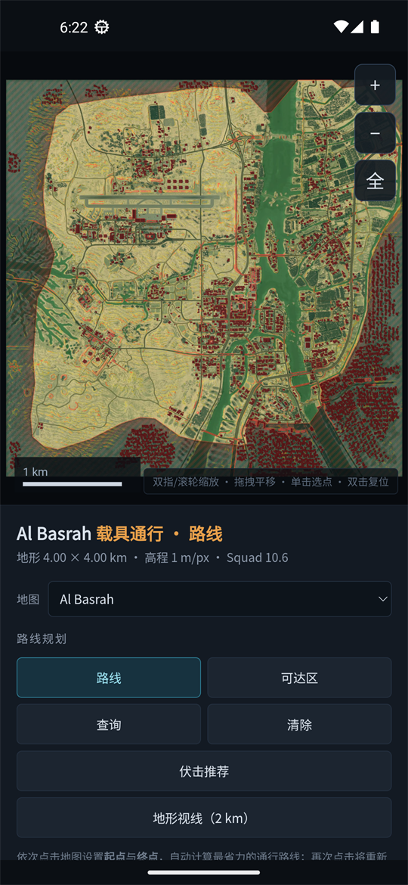

## 载具类别与直升机着陆地

面板“载具类别”四选一，切换后立即按新类别重算着色、路线与可达区：

- **陆地载具**：水、密林、建筑、围墙、超坡都不可通行；道路/硬地按豁免规则处理。
- **两栖载具**：水域视为完全可通行；陆地仍按坡度与树冠判定。
- **水面舰艇**：只走水域。没有“水面舰艇航道”标注时直接用水域；画了航道后取
  **水域 ∩ 航道**，陆地和未画航道的零散水塘不会变成航线。
- **直升机**：不再算地面路线，改为计算着陆地。默认坡度 ≤ 5°、树冠覆盖 ≤ 10%，
  两个上限都可在面板滑杆调整；连续可着陆区域按面积排序，取最大的 5 块标为 A–E。
  地图上绿色为可着陆像素，字母圈为候选中心；点击候选可看面积与坐标。

坡度预设按钮（轻型轮式 12° / 运输卡车 16° / 履带 IFV 22° / 主战坦克 26°）仍保留，
只影响地面类别的坡度上限；水面舰艇与直升机不受这些预设限制。

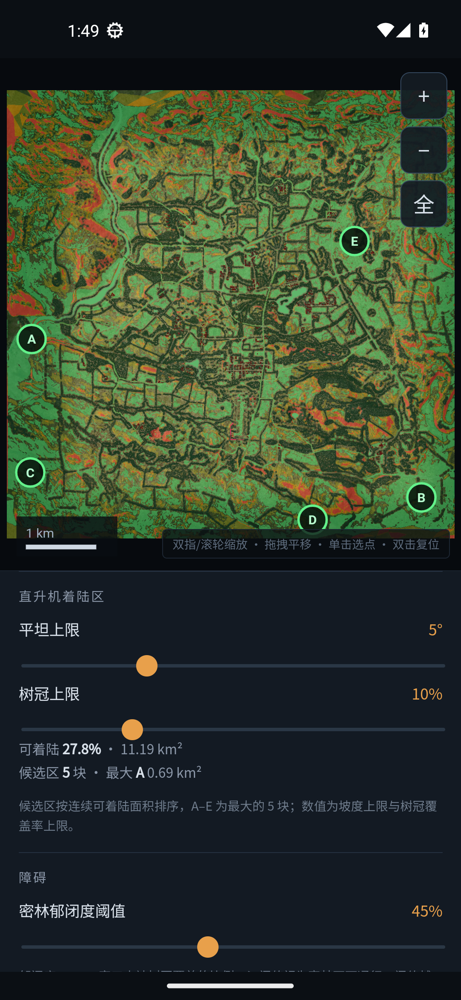

## 水域与桥梁

- **海洋 / 深水河**：按 SquadCalc 的 **topomap** 图层（水体接近黑色）加底图颜色识别，
  生成 `IMG_WATER` 掩膜。对**陆地载具**水域是硬障碍（`classify() = 6`），路线/可达区/
  伏击都不会进入；**两栖**视为可通行；**水面舰艇**只在水域内计算。
- **起点/终点**：陆地类别点击水面时，`nearestPassable()` 找最近的 `cost > 0` 格，
  标记落在最近的岸/桥/道路，不会留在水里；大面积水域 26 格内找不到落点时该次点击被忽略。
  两栖与舰艇则允许直接点在水面上。
- **桥梁**：由“道路跨水”与 3D 桥梁实例（label 含 bridge/viaduct）识别，生成 `IMG_BRIDGE`；
  `classify()` 首先检查桥面，桥面直接返回可通行，覆盖水、树、建筑和围墙判定。
- 面板图例新增 **海洋/深水河（不可通行）** 与 **桥梁（绝对可通行）**；查询浮卡会显示
  “深水（不可通行）”或“桥梁 / 桥面（绝对可通行）”。

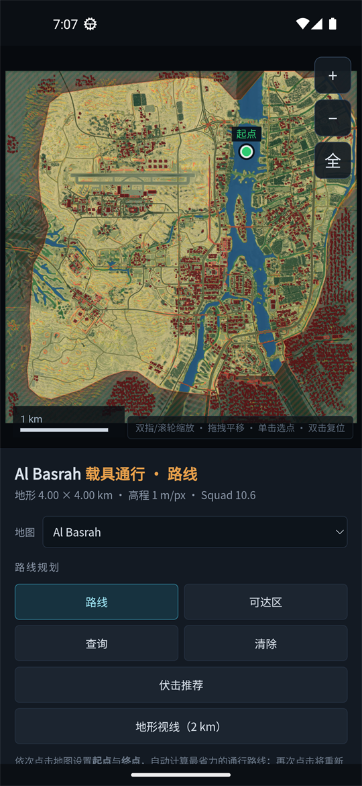

限制：

- 水体识别是栅格近似，只识别 topomap 中足够暗的深水；浅滩/可涉水河段不会自动标成障碍。
- 桥面优先级最高，但用户自定义禁区仍会覆盖桥（禁区是显式约束）。

### 桌面手动标注器

自动水体识别不可靠，已另做独立电脑端程序：

- 运行 `start-map-annotator.bat`，或 `dist/map-water-bridge-annotator.exe`。
- 左侧 25 张官方图；图层下拉：
  **水域、桥梁、地图边界内、通畅道路、不可通行障碍、水面舰艇航道**；可切地形图看水体。
- 地图边界内：画闭合多边形包住可玩区域；没画则默认整图有效。
- 通畅道路：树冠/桥下遮挡但实际可走的路；覆盖树冠/建筑，不覆盖水。
- 不可通行障碍：护栏/围栏/石堆；优先级最高（边界外除外）。
- 水面舰艇航道：舰艇专用；只在 App 的“水面舰艇”类别下生效，地面载具忽略。
- **水域→舰艇**：一键把当前水域掩膜复制到航道层，再在航道上补画/擦除；
  适合“整片水域都能走、只修几条窄航道”的图。
- 多边形左键逐点；**撤销键删除上一个点**；双击/Enter/“完成多边形”闭合；
  “取消多边形”放弃当前点。
- 标注保存到 `annotations/<slug>/`：water / bridge / boundary / clear_road / obstacle / boat，
  均为 2048×2048。
- `tools/build_maps.py` 优先使用手动文件并下采样到 1024；没标注的图回退自动识别。
- 标完后运行 `python tools/build_maps.py` 并重新构建 APK。


**MOD 地图未打包**：SquadCalc 的 SuperMod / Global Conflict 地图是独立 mod 内容，
不在当前 APK 内；当前为 25 张官方图。

### 地图数据从哪来

- `tools/maps_catalog.json`：25 张官方图的名称、边界、SDK 高度缩放。
- `tools/download_maps.py`：从 SquadCalc 下载每张图的 heightmap、basemap、
  topomap、3D trees/props 实例（本机缓存到 `.tmp/maps_source`，不进 APK）。
- `tools/build_maps.py`：解码高程 → 坡度 → 底图 JPEG → 道路掩膜 →
  3D 树/建筑/围墙栅格化 → 生成每页 HTML。
- 依赖（仅构建机）：`pillow`、`numpy`。
- 修改根目录 HTML 后运行 `python tools/build_maps.py` 重新生成 25 页；
  只改一张图时可用 `--only <slug>`。

## 直接安装（荣耀 WIN RT / MagicOS）

APK：`dist/Yehorivka-Passability-0.43.4.apk`（54.02 MB / 56,644,206 字节；minSdk 26 / targetSdk 35；无权限、离线）

SHA256：`AF82922669A123BF68D990B8145B6A3329A21348DD51E73C62156E1847872D5D`

1. 把 APK 传到手机（USB / 文件管理器 / 网盘）。
2. 设置 → 安全 → 更多安全设置 → **安装外部来源应用**，允许文件管理器。
3. 如果开启了**纯净模式**，先关闭/退出，否则会拦截安装。
4. 点 APK → 继续安装；出现“未通过安全检测”时选择继续。
5. 桌面出现 **Squad 载具通行**，打开即可。

ADB（手机开启 USB 调试）：

    adb install -r dist/Yehorivka-Passability-0.43.4.apk

> release 用 debug keystore 签名，方便个人侧载；**不是** Play 商店签名。

## 使用

- **主基地部队编成**（0.40.0 / 0.41.0）：在「敌情标记」面板顶部选 **阵营 → 对局类型 → 具体部队**，
  下面列出该部队的载具（含开局 / 延迟 N 分、重生、票值、座位）、人员名额、可用工事与指挥官技能；
  底部「复制该部队编成（文本）」把清单复制成文字。0.41.0 起 **对局类型由「旗点 · 占领区」里选的那一局自动判定**
  （提示行写明「旗点 Invasion · 大图 → 已自动选 大图 · 进攻方」），换旗点图层即跟着换；
  想自己指定就改一下对局类型，会转成手动并出现「恢复跟随」。选择与跟随开关按本机记忆，重开保持。
- **路线**：点起点，再点终点；再点起点会重新开始。
- **可达区**：点地图任意位置，绿色区域即不越坡不穿林可达范围。
- **查询**：点地图任意位置，浮动卡片显示类别 / 高程 / 坡度 / 树冠覆盖 / X/Z；切换模式后卡片收起，
  网格点与键位十字留在图上（0.18.0 起也会被记住，重开地图还在）。0.42.0 起标记点上还有一支**琥珀色
  坡度箭头**，指向下坡最快方向；「网格坐标」里的「显示坡度箭头」可随时关掉，关掉后只留十字，按地图记住。
  卡片标题现在是**网格坐标**（如 `K8-5-4`），下方面板同步显示，可点“复制坐标”。
  0.43.0 起地图右侧有 **查询 / 测距** 按钮（放大键下面，0.43.4 起再加一个 **通视分析** 眼睛按钮）：点「查询」直接弹 **查询坐标对话框**，
  输坐标回车即定位，或点「点地图得坐标」（带手指图标）再点地图——点完结果框自动弹出。点「测距」直达测距面板。
  各模块切换时的面板自动下滑也提速到约 120 ms（原先原生 smooth 约 600 ms）。
- **网格坐标**：勾选“显示网格坐标系（300 m）”（或直接点“定位”）后地图叠加网格；0.43.1 起这个复选框是
  网格的唯一开关，取消勾选立刻收起网格（十字标记与读数保留），选择按地图记住；
  在上方输入框敲 `D3`、`D3-7` 或 `D3-7-4` 回车/点“定位”即跳到该格并把该格框成绿色；
  也可以直接点地图取值。“清除标记”去掉绿框与读数。
- **禁区**：先选“圆形/矩形”，再点两次；清空禁区按钮在下方。
- **矩形旋转**：矩形禁区右侧有 −15° / +15°；攻击区/安全区右侧也有同样按钮；下方另有滑杆可微调。
- **伏击推荐**：点“伏击推荐”→ 选圆形/矩形 → 先点攻击区（圆心+半径 / 两角）→
  再点安全区。程序自动推荐；点结果行或地图编号切换伏击点，绿色线是撤退路线。
  距离标记：**推荐** 500–800 m，**偏远** >800 m，**偏近** <500 m。
- 面板向上滑可看到载具类别、坡度、树冠、图层、图例和统计；切“直升机”后
  同一块面板会出现“平坦上限 / 树冠上限”和 A–E 候选统计。
- **区域入口 · 架枪位**：点“区域入口 · 架枪位”→ 选圆形/矩形 → 两次点击圈出区域。
  面板列出每个入口的宽度/坡度/树冠/距中心，以及每个架枪位的分数、距入口、射界、类型；
  上方“武器有效射程”滑杆 50–2000 m（默认 800 m）控制架枪位的最远距离，改完自动重算；
  点入口行或地图 A–F 切换，点 P 行或地图标记高亮。
- **最近隐蔽点**：点“最近隐蔽点”→ 点地图设起点；面板显示搜索半径、候选数、隐蔽度、
  距起点距离、类型与树冠/低洼/坡度/周边较高，紫色圈为搜索范围，H 为结果。
- **隐蔽推进 · 沿线射界**：点按钮 → 选圆形/矩形 → 先点区域外的集结点 → 点区域中心 →
  点半径/对角。路线按隐蔽度分绿/黄/红；点 T1–T5 行或地图标记查看对应射界锥。
  `射界` 是可见路线样本比例；密林硬遮挡强时百分比会偏低，但至少保留能看见一个样本的点。
- **区域分区 · 观察点**：点按钮 → 选圆形/矩形 → 两次点击圈出区域。面板显示分区数、
  观察点数、可观察比例、面积与采样格数；每块列 2–5 个点，写“联合覆盖 100%”、
  主点、单点覆盖率和距块心距离；点区块行或地图 A–E 切换，点 O 行或地图标记高亮。
- **文件**：顶部「文件」栏 → **新建**（清空本图，可撤销）/ **打开**（选本机文件）/ **保存**（覆盖当前文件）/ **另存为**（用输入框的名字新建）。
  下面还有 **导出 / 分享**（发 QQ、微信）与 **从文件导入**。
- **清错东西**：每个模块上面都有一行 `<模块名> 清除 撤销 重做`；顶部还有 **全部清除**。
  撤销一次 = 撤回一个动作（连续拖动算一步），重做可以再推回去。
- 水面舰艇没有航道标注时直接用水域；需要限制在固定航道时，先在桌面标注器画航道，
  再重新生成地图页；只画水域不画航道也能开船。
- 横屏旋转后布局自动切换；若视角没复位，点右上角「全」。

## 网格坐标（0.15.0）

和游戏里同一套键位，所以队友报的 `D3-7-4` 可以直接输进来，也可以把地图上看到的位置按同一套规则报出去。

- **主格 300 m**：列用字母 `A`…`V`（22 列），行用数字 `1`…`22`（22 行），**图左上角是 `A1`**；
- **一级子格 100 m**：每个主格切成 3×3，数字按**小键盘**排：左上 `7`、上 `8`、右上 `9`；
  中左 `4`、中 `5`、中右 `6`；左下 `1`、下 `2`、右下 `3`；
- **二级子格 33 m**：再切一次，同样的 1–9 排布（`7 8 9 / 4 5 6 / 1 2 3`）；
- 因此 `D3-7-4` = 主格 `D3` → 100 m 子格 `7`（左上）→ 33 m 子格 `4`（中左），精度约 33 m。

用法：

- 勾 **显示网格坐标系（300 m）**：主格画亮线，每格左上角标 `A1` / `B4` 这样的标号；放大后自动
  出现 100 m 细线和小键盘数字，再放大还有 33 m 细线。
- 缩到整图时只留顶部/左侧一条**标尺**（字母 + 行号），不把屏幕糊满。
- **点地图取坐标**：浮卡标题、下方面板、输入框三处同时给出 `D3-7-4` 这种三级坐标。
- **输坐标定位**：敲坐标后回车或点「定位」，地图缩到 1.2 倍并把该格居中、框成绿色；
  输 `D3` 就只标到 `D3`，输 `D3-7` 就标到一级子格（标号深度跟随输入段数）。
- 每一级子格**只接受 1–9 的单个数字**（小键盘 `789 / 456 / 123` 排布）。0.43.3 起
  `G10-3-12`、`G10-3-0`、`H7-11-2` 这类「多位 / 越界数字」**一律判为不合法并说明原因**，
  不再像更早版本那样把两位数字当成「列 1–3 + 行 1–3」静默折算成别的格子。
- 容错：`d3-7-4`、`D03-07-04`（子格补零）、`D3 7 4`（空格 / 逗号当分隔符）都能解析；
  `ZZ99`、`J25-1`（超出本图行列）、`D3-7-4-1`（多于两级子格）会明确提示错在哪。
- 坐标换算与浮卡里的世界坐标一致：网格原点就是图左上角（`MINX` / `MINZ`），列号沿 X 增大、
  行号沿 Z 增大，和 SquadCalc 的 `getKP()`（`src/js/squadMinimap.js`）定义相同。


## 敌情标记 · 图标（0.16.0 起步，0.16.2 改为矢量，0.16.3 修图层抵消，0.19.0 两模式 + 旋转，0.20.0 状态 + 箭头 + 最上层，0.21.0 自定义标签 + 图上文字 + 箭头提示）

面板顶部按钮 **敌情标记 · 图标**。图标取自游戏资源里的官方地图图标（SquadCalc 的
`public/img/icons`，MIT），SVG 原图在 `icons/`。

0.16.2 起统一走**矢量**：`icons/markvec.js`（775 KB）把 112 个 SVG 的 `path d`、填充色与
变换矩阵导出成 JSON，页面用 `new Path2D(d)` + `ctx.fill()` 现场绘制（按 DPR 设置画布像素），
所以 26 px 的缩略图和放大的地图标记都是原始曲线的栅格化结果，不是位图缩放。
`assets/icons/png/{64,256}/` 的两档 PNG（224 个 / 0.98 MB）保留为兜底：
若 `markvec.js` 加载失败（`onerror`），自动退回 `drawImage`。
`markvec.js` 是一次性离线生成的：headless 浏览器解析 `icons/` 里的 SVG（path/rect/circle/polygon…，
累积 `DOMMatrix`），导出成 JSON 后落到 `icons/markvec.js`，运行时不再依赖 DOMParser。

用法（0.19.0 起分 **新建 / 选择** 两档，默认“新建”）：

1. 点 **敌情标记 · 图标** → 选 **新建** 或 **选择 · 移动 / 旋转**；
2. 选 **敌方（红）** 或 **友方（蓝）**，再选分类 **步兵**（6）/ **载具**（89）/ **工事**（15），点一个图标；
3. **新建** 模式下点地图落点：标记以深色圆底 + 红/蓝环 + 白色剪影画出，尺寸随缩放（**4–18 px**：
   整图时约 4–7 px（0.16.1 起为原先 1/4），放大到 2–3 倍后长到 13–18 px，看得清细节；
   因为走矢量绘制，放大不会糊；点按命中半径仍是 16–26 px，小标记也好点）；
4. 落点后该标记自动选中，下方出现 **旋转 −15° / 旋转 +15°** 与 0–359° 滑杆，拖动即时改角度
   （选中时另有一条指向当前朝向的蓝线）；
5. **选择** 模式：点地图上的标记选中，**按住它拖动**即可改位置（松手落盘），点空白取消选中；
   在“选择”模式下点一个图标会自动切回“新建”，避免误以为选中了图标就能拖；
6. 列表里每行显示 `图标名 · 敌/友 · 网格坐标 · 角度`（角度为 0° 时省略，
   如 `map_hat · 敌 · D3-7-4 · 45°`），右侧 `×` 删除；
7. **复制列表** 输出制表符分隔的文本（`D3-7-4<TAB>敌军<TAB>步兵`），可粘贴到群里报点；
8. **清除全部** 清空当前地图的标记。

- 标记按地图分别存进 `localStorage`（键 `sqmarks:<地图文件名>`），切图不串、重进仍在。
- 每条标记的结构是 `{ gx, gy, f, team, a, lb?, st?, stn?, arr? }`：`a` 是 0–359 的角度（旧存档没有 `a` 时按 0° 处理），
  `lb` 是自定义标签（0.21.0），`st`/`stn` 是状态与受损备注（0.20.0），`arr` 是箭头（0.20.0）；
  这些都随 `sqmarks:` 与存档导出 / 导入走，不用改存档格式。
- 0.19.0 从选择器里删掉了 `deployable_fob_blue` 与 `deployable_hab_activated` 两个条目；
  `markvec.js` 与 PNG 里这两个资源仍在（没删文件），只是不再列出。
- 标记在任何模式下都会画出来（路线、查询、视线……），所以可以边规划边标敌人；
  0.20.0 起 `draw()` 里的 `drawMarks()` 被挪到 `drawLines` / `drawMarkers` / `drawMeasure` / `drawHeloZones` /
  `drawLosMarkers` 之后、比例尺之前，**敌情标记永远是最上层**，其他模块的线框和文字压不住它。

### 自定义标签 + 图上文字（0.21.0，仅“选择”模式）

选中标记后，面板最上方出现 **自定义标签** 输入框（最多 24 字，如 `BTR-82A` / `T-72B3` / `侦察班`）→
**保存标签** 落盘（回车也行）→ 该文字立刻画在地图上的标记右侧；**删除标签** 清空。

- 颜色随状态走：受损 = 琥珀 `#ffc266`，阵亡 / 摧毁 = 灰 `#c3ccd6`，友方 = 浅蓝 `#a8d3ff`，敌方 = 浅红 `#ffc2bc`；
- 文字牌是深底（`rgba(8,12,18,.86)`）+ 9 px 内边距，靠右边界时自动翻到标记左侧，不会跑出画布；
- **受损备注也会画到地图上**：标签下方第二行 `受损：<备注>`（琥珀色），两行上下错开
  （`off2 = Math.max(10, sz * 0.95)`，标签在上、备注在下），不会互相压住；
- 列表行显示为 `AAT_Top「BTR-82A」· 敌 · J9-8-4 · 受损：履带被打断 · 1 箭头`；
- 数据是 `m.lb`（字符串，空 = 无标签），`markMapTag(x, y, text, color)` 负责画，`markSaveTag()` / `markDeleteTag()` 负责增删。

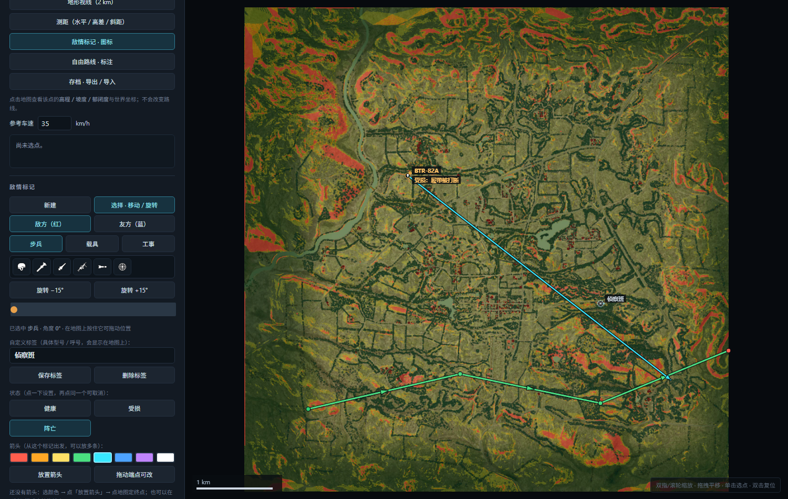

### 状态（0.20.0，仅“选择”模式）

选中一个标记后，面板出现 **状态** 三个按钮，按图标分类给不同的第三项：

| 分类 | 三档状态 |
|---|---|
| 步兵（6 个） | 健康 / 受损 / **阵亡** |
| 载具（89）、工事（15） | 健康 / 受损 / **摧毁** |

- 再点同一个按钮 = **取消**该状态（回到普通红/蓝环）；**删除状态** 按钮一键清空状态与备注。
- 选 **受损** 时下方出现备注输入框（最多 60 字，如“履带被打断”），回车或 **保存备注** 落盘；
  只写备注不点状态时按“受损”处理。
- 画法：**健康** = 队色环（敌红 `rgba(255,93,77,.95)` / 友蓝 `rgba(77,163,255,.95)`）；
  **受损** = 琥珀环 `rgba(255,184,77,.95)` + 右上角橙色 `!` 徽标；
  **阵亡 / 摧毁** = 灰环 `rgba(154,167,180,.95)` + 图标半透明（`globalAlpha 0.55`）+ 打一个十字叉。
- 数据存在标记对象上：`m.st`（`'' | 'ok' | 'hurt' | 'dead' | 'destroyed'`）、`m.stn`（受损备注），
  跟着 `sqmarks:` 与存档 JSON 一起走，不用改存档格式。

### 箭头（0.20.0，仅“选择”模式）

1. 选中标记 → **箭头** 区选 8 色之一（默认 `#ffe066` 淡黄）；
2. 点 **放置箭头** → 点地图定终点，箭头从**该标记**画到落点（箭头三角 + 深色描边，缩到 4–7 px 也看得出方向）；
3. 一个标记可以放**多条**箭头（各带各的颜色），列表每行 `箭头 N · 至 <网格坐标>`，
   右侧 **改终点**（再点一次地图重定终点）/ **×**（删除）；
4. 也可以在“选择”模式里**直接拖箭头端点**改方向（命中半径 14 px，松手落盘）；
5. 数据是 `m.arr = [{ x, y, c }]`（`x/y` 是地图像素坐标，`c` 是颜色），随标记一起持久化。

**0.21.0 的操作提示**（放箭头时不会不知道点哪儿）：

- 点 **放置箭头** 后按钮变成 **取消放置（Esc）**、右侧提示从「拖动端点可改」变成「点地图定终点」；
- 地图上从该标记拉出一条**青色虚线**跟着鼠标 / 手指走，起点是虚线圆、光标处是空心圆端点（`#8fe7ff`），
  松手前就能看见落点；
- 提示行换成「**放置箭头**（起点：<图标名>）：**点地图**确定终点，虚线就是预览；按 **Esc** 或再点「取消放置」放弃。」；
- 键盘 **Esc** 或再点一次按钮即取消（清掉 `arrowArm` 与 `markHover` 后重绘）。

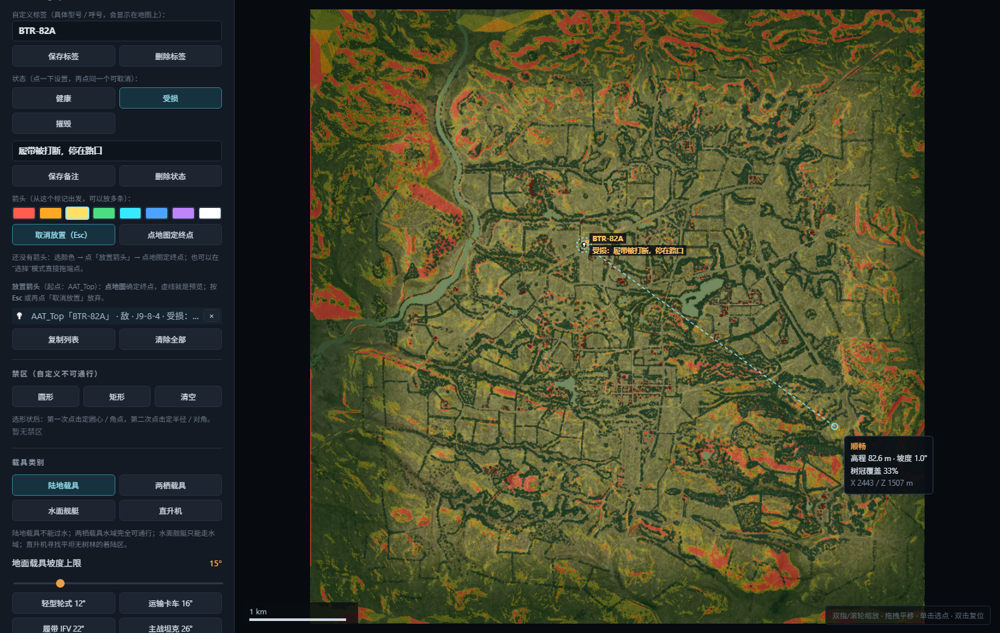
- 箭头在 `drawMarks()` 里**先画**、图标**后画**，所以箭头永远压在图标下面、不会挡住图标本体。
- 图标在 `file:///android_asset/maps/*.html` 里用相对路径 `../icons/markvec.js`（兜底
  `../icons/png/256/`）引用，桌面版（HTML 放在仓库根目录）则用 `icons/markvec.js`，
  同一套代码两边都能跑。

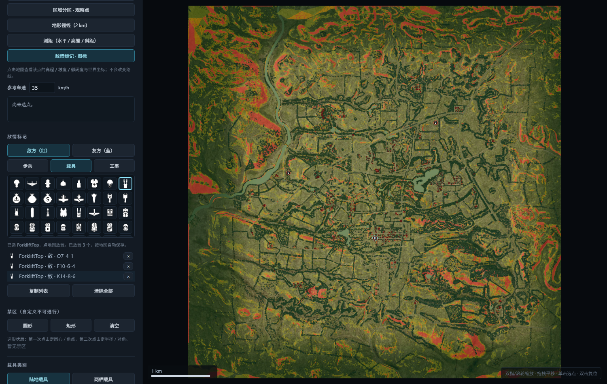

## 自由路线 · 标注（0.17.0）

面板顶部按钮 **自由路线 · 标注**。原来的「路线」是 A* 自动算出来的；这里是**手画**的任意折线，
适合标进攻轴线、补给线、撤退路线、巡逻路线。

1. 点 **自由路线 · 标注** → 在色板里挑颜色（10 色：红 / 橙 / 黄 / 绿 / 青 / 蓝 / 紫 / 粉 / 白 / 灰）；
   选颜色会改正在画的线，或改**已选中的那条线**；
2. 点 **开始画线** —— 此时地图自动**固定**（「固定地图」按钮默认亮着：拖动 / 双指缩放 / 滚轮都不响应，
   否则手指一画就把地图拖走了）；
3. 点地图加点，**按住拖动可连续画**（相邻点屏幕距离 < 2.5 px 自动合并，避免一秒钟上千个点）；
4. **撤销点** 退掉最后一点，**取消** 丢弃未完成的线，**完成** 保存（至少 2 个点）；
5. 保存后点线上的**任意一个点**（含起点 / 终点）→ 下方出现备注框，输入文字 →
   **保存备注**（回车也行）或 **删除备注**；备注画成深底彩色小标签贴在该点旁（整图缩得很小时自动隐藏，避免糊成一团）；
6. 点线身（不是点）可选中整条线（虚线高亮），再点色板直接改色；列表每行 `路线 N · 点数 · 备注数`，右侧 `×` 删除。

- 数据存 `localStorage`，键 `sqlines:<地图文件名>`，结构 `{id, name, color, pts:[{x, y, n?}]}`
  （`x/y` 是 0..N 的地图像素，`n` 是该点备注）。
- 线宽随缩放：`Math.max(2, Math.min(5, size * 0.003))`，外加深色描边，任何底图上都看得见；
  起点绿点、终点红点、中间点用线色；命中判定 16 px（顶点）/ 12 px（线身），手指也点得准。
- **0.21.0 起每一段自动带方向箭头**：在 `lineTrace()` 里对相邻两点连线，段长 ≥ 16 px 就在**中点**画一个
  沿走向的小三角（`hd2 = Math.max(4.5, Math.min(9.5, w * 2.6))`，张开 ±2.6 rad），先深色描边再填线色，
  所以无论线多细都能看出进攻方向；段太短（< 16 px）时省掉，避免糊成一团。
- **固定地图** 可以手动关掉（按钮变灰），关掉后画线时也能拖动 / 缩放，但容易误触，默认开着；
  离开本模式时若还有没保存的线，会自动丢弃。

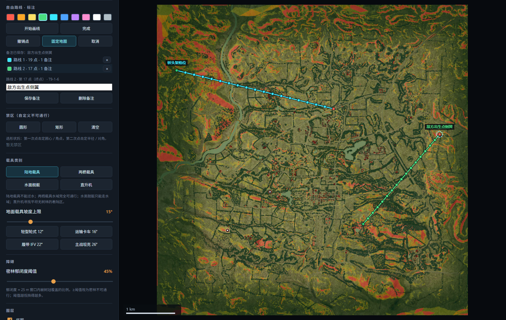

## 存档 · 导出 / 导入（0.17.0，0.18.0 带分析结果，0.21.0 带地图名 + 自动切图）

面板顶部按钮 **存档 · 导出 / 导入**。存档 = 当前地图的**敌情标记 + 自由路线（含每个点的备注）
+ 分析结果**，连同**所属地图名**打成一个 JSON。

1. 填名字（可空）→ **保存**：写进本机 `localStorage`（键 `sqarch:<地图文件名>`，最多留 40 条）；
   列表每行 `存档名 · 时间 · 地图 X · N 标记 · M 路线 · K 分析`，右侧 **载入 / 分享 / ×**；
2. **导出 / 分享** 导出**当前画面**；列表里的 **分享** 导出那一条历史存档；
3. **从文件导入** → 系统文件选择器选一个 `.json` → 直接载入并覆盖当前画面的标记与路线，可继续编辑。
   **0.21.0 起如果存档属于别的地图，App 会自动切过去**：把原始 JSON 暂存到 `localStorage` 的 `sqpending`，
   再跳到 `<地图>.html`，新页面加载时由 `archApplyPending()` 取出并导入，提示「已从存档导入（地图 Skorpo）：…」；
   若本 App 没有那张图，报「存档属于地图「x」，但本 App 没有这张地图」，不动当前画面。

存档格式（0.18.0 起 `ver: 2`，`ver: 1` 的旧档仍能导入）：

    {"app":"yehorivka-passability","ver":2,"map":"yehorivka",
     "savedAt":"2026-10-23T06:41:00.000Z",
     "marks":[{"gx":184,"gy":305,"f":"AAT_Top","team":"enemy","a":90,
               "lb":"BTR-82A","st":"hurt","stn":"履带被打断",
               "arr":[{"x":555,"y":478,"c":"#ffe066"}]}],
     "lines":[{"id":"L1761...","name":"路线 1","color":"#38e8ff",
               "pts":[{"x":92.9,"y":512,"n":"桥头架枪位"}]}],
     "ana":{"route":{…},"insp":[…],"meas":[…],"ana":…}}

`map` 是地图 slug（`yehorivka` / `skorpo` …），0.21.0 起列表里按它的中文名显示，导入时按它切图。

手机上走**原生桥**（`MainActivity.ArchiveBridge`，注入名 `YehorivkaBridge`）：

- `exportArchive(fileName, json)`：先把 JSON 写一份到 `getExternalFilesDir("archives")`，再用
  `MediaStore.Downloads` 在 **下载 / Yehorivka** 下建一个真文件（`application/json`，`IS_PENDING` 收尾），
  拿到 `content://` 后弹 `ACTION_SEND` + `EXTRA_STREAM` + `FLAG_GRANT_READ_URI_PERMISSION` 的系统选择器 →
  直接发给 **QQ / 微信 / 邮件**；文件名形如 `yehorivka-20261022-2357.json`。
  Android 10 以下（26–28）没有 `MediaStore.Downloads`，退化为分享**文本**（JSON 正文），文件仍留在 App 私有目录。
  没有引入 androidx `FileProvider`（工程不加依赖，避免离线构建失败）。
- `pickArchive()`：`ACTION_OPEN_DOCUMENT`（`*/*` + `application/json` 等 MIME）→ 读流（上限 8 MB）→
  `webView.evaluateJavascript` 把 JSON 交给页面 `window.__yhImport`。
- 桌面版没有桥：导出退回 `Blob` + `<a download>`，导入退回隐藏的 `<input type=file accept=".json">` + `FileReader`，
  所以同一个 HTML 在浏览器里也能存 / 导。
- 导入会校验 `app === "yehorivka-passability"`，不是本 App 的文件报「这不是本 App 的存档文件」。

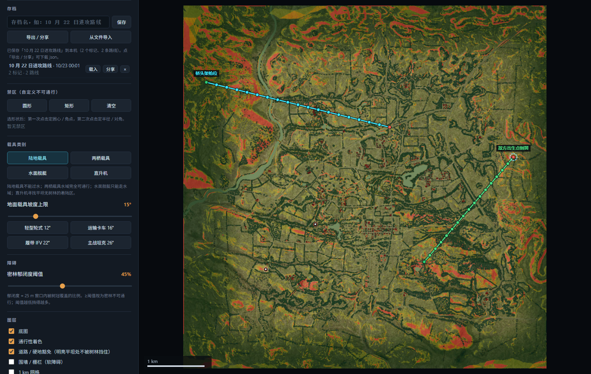

## 地图数据 · 在线更新（0.39.0）

### 数据从哪来

25 张图的**底图 / 等高线 / 坡度 / 高程 / 道路 / 围墙 / 障碍 / 水面 / 桥梁 / 边界 / 树冠 / 旗点**
被打包成 25 个 `<slug>.json`，加一个 `manifest.json` 清单，放在公开仓库
[copperbookworm/Yehorivka-MapData](https://github.com/copperbookworm/Yehorivka-MapData) 的 `maps-data/` 下：

```
https://raw.githubusercontent.com/copperbookworm/Yehorivka-MapData/main/maps-data/
    manifest.json          # 每张图的名字 / 版本 v / 字节数 size / sha256，还有各图的内置版本
    yehorivka.json         # 单图数据包（本图 2.7 MB，25 张共约 63 MB）
    al_basrah.json ...
```

数据包是 `{schema:1, slug, name, v, minx, maxx, minz, maxz, lo, hi, img:{BASE,TOPO,SLOPE,ELEV,ROAD,
WALL,OBST,WATER,BRIDGE,BOUND,CLEAR,MBLOCK,BOAT,TREE}, flag_db, flag_cn}`；`v` 是**内容版本**
（= 不含 v 的序列化 sha256 前 12 位），内容一变 `v` 就变，App 据此判断「有没有更新」。

### App 里怎么用

面板里滚到 **地图数据 · 在线更新**（在「统计」下面）：

1. **检查更新** —— 读 GitHub 上的 `manifest.json`，显示「远端版 <v>（2.7 MB）· 已是最新 / 有更新，可以下载」；
2. **下载本图** —— 只下当前这张图；**下载有更新的** —— 把清单里比本机新的图一次下完（会先问一次，再点一次确认）；
   下载时那一行会实时显示百分比；
3. 下完**自动重载页面**，状态变成「本机已下载 <v>（2.7 MB）· **正在用它**」——地图、坡度、树冠、旗点全部来自本机包；
4. **删除本图数据** —— 删掉本机包，重载后回到安装包内置的那份（状态回到「本机没下载」）。

数据源输入框默认填的就是上面那个 raw 目录，可以改成自己的镜像（末尾带 `/`），改完点「检查更新」重新读清单。

### 实现

- **Android 走原生桥**（`MainActivity.ArchiveBridge` 新增 `mapPackGet / mapPackInfo / mapPackList /
  mapPackDelete / mapPackDownload / netGet`）：`HttpURLConnection` 在后台线程下载，**边下边算 SHA-256**，
  大小与哈希都和清单对上才把 `.part` 原子改名成 `<slug>.json`；包存 `getFilesDir()/maps/`，
  `index.json` 记 `{v, size, t}`。上限 24 MB/包、2 MB（清单）。
  进度与结果通过 `runOnUiThread` → `evaluateJavascript` 回调页面（`window.__mapDl` / `window.__netGet`）。
- **桌面浏览器没有桥**：退回 `fetch` + `localStorage`（键 `mappack:<slug>` 与 `mappack.meta`），
  同一套逻辑在 Firefox 里验证过（raw 有 `Access-Control-Allow-Origin: *`，`file://` 页面也能读）。
- **页面启动**时先问桥要本机包（`mapPackGet`）：有就覆盖页面里内置的 `MINX/MAXX/MINZ/MAXZ`、`ELEV_LO/HI`
  与 14 个 `IMG_*`（data URL），并覆盖 `FLAG_DB / FLAG_CN`；没有就用页面内置数据 —— 所以**断网、删包都不会白屏**。
  注意覆盖必须显式写 `BASE = ...` 这种赋值，**不能用 `window['IMG_'+k]`**（页面本身是个 IIFE，`var` 不在 window 上）。
- **构建**：`tools/build_maps.py` 生成页面时同时把数据包写到 `dist/maps-data/` 并合并 `manifest.json`
  （`builtin` 记每张图的内置版本，这样任意一页都知道别的地图的内置版本）。发布 = 把 `dist/maps-data/`
  整个推到这个仓库，App 侧不用动。
- **manifest 比对按字节**：桌面分支用 `arrayBuffer()` 取 `Uint8Array.length` 比大小，`TextDecoder` 转文本
  ——早先用 `r.text().length` 比大小，中文旗点名是多字节，会误报「大小不符（2843045 ≠ 2843595）」。

## 区域标注 · 圆形 / 矩形（0.22.0）

点面板里的 **区域标注 · 圆形 / 矩形**，然后（**0.38.0 起先起名，再定形状**）：

1. 在上面那个输入框里写名字（最多 20 字，如 `A 点` / `东侧集结区` / `弹药点`），点 **应用名称**——
   名字确认后 **圆形 / 矩形** 两个按钮才解锁（没确认前是灰的，点不动）；
2. 选 **圆形** 或 **矩形**；
3. 点地图第一下定圆心 / 第一个角，第二下定半径 / 对角——区域立刻出现，名字显示在区域中心；
4. 名字画一次就用掉：输入框清空、形状按钮重新锁上，接着画下一个要**重新起名 + 点应用名称**。
   没起名时点地图**不会**新建区域（只会提示先起名）。

画完不自动选中区域（否则下一个名字会被当成给刚画的区域改名）。要**改名**点列表该行的「改名」，
改完再点 **应用名称**；要**删除**点该行的「×」；选中某行后**再点这一行**可取消选中，回去给新区域起名；
选错形状时点 **取消本次选点**。

- 每个区域自动分配一种颜色（`#38e8ff` / `#4ade80` / `#ffe066` / `#ff8fd0` / `#c084fc` / `#ffa726` 循环），
  填充透明度 0.13、边框虚线；列表里带彩色色块、面积描述（`圆形 · r 783 m` / `矩形 · 874×589 m`）。
- **颜色可以自己改（0.25.0）**：选中区域后下方多一行「<区域名> 颜色」，见下面的「区域颜色（0.25.0）」。
- **只是标注，不改通行性**：和「禁区」（会参与 A*、把代价置 0）完全分开，画区域不会影响路线与可达区计算。
- 数据存 `localStorage`，键 `sqregion:<地图文件名>`，结构：
  圆形 `{ id, name, type: 'circle', cx, cy, r, color }`；矩形 `{ id, name, type: 'rect', x0, x1, y0, y1, color }`
  （坐标是 0–1024 的地图格，和「禁区」一致）。`color` 是区域颜色（0.25.0 起可手动改）；
  矩形另有 `angle`（0–359°，0.24.0 起支持旋转）。
- 随**存档 · 导出 / 导入**一起走：`mapSnapshot()` 里带 `regions`，导入时一起恢复（摘要会写「N 个区域」）。

### 矩形旋转（0.24.0）

点列表里某个**矩形**的名字把它选中（选中行高亮），区域下方出现一行 **「<区域名> · 旋转」**：
**−15° / +15°** 两个按钮，加一条 **0–359°** 滑杆（可拖）。

- 旋转**绕矩形中心**，区域名跟着中心走；列表里写 `矩形 · 1947×1191 m · 15°`。
- 角度写进 `regions[i].angle`，随存档导出 / 导入；圆形没有角度，选中圆形时这一行自动隐藏。
- 旋转同样可以撤销（区域模块的「撤销」）。

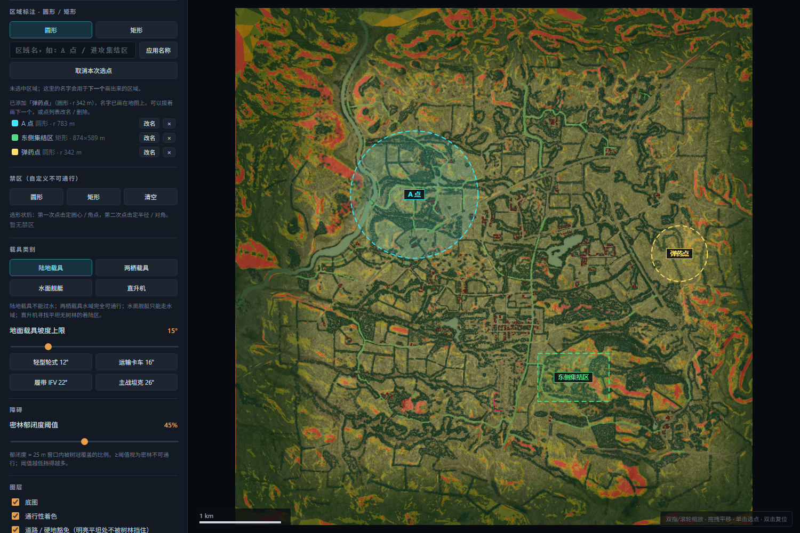

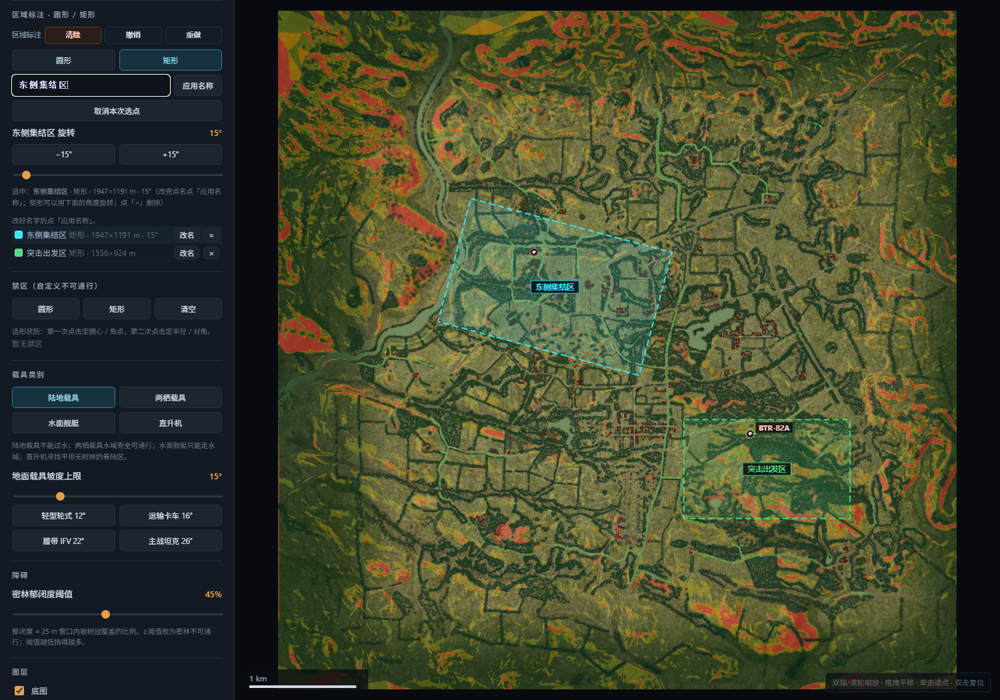

### 区域颜色（0.25.0）

点列表里某个区域（圆或矩形都行）的名字把它选中，区域下方出现一行 **「<区域名> 颜色」**，右侧显示当前色值：

1. **快捷色板**：10 个色块（默认 6 色循环 + 红 / 蓝 / 浅灰 / 灰蓝），当前色那一块带**白边**，点一下立刻改色；
2. **取色器**：色板下面那条彩色输入框，点开可选**任意颜色**（手机上是系统自带的取色面板）；
3. **用默认色**：一键把该区域还原成自动分配的那个颜色。

- 改完立刻生效：地图上的填充 / 虚线边框、中心文字牌、列表左侧色块一起变；提示行会写「已把「A 点」的颜色改成 `#ff5d4d`。」
- 颜色写进 `regions[i].color`，随存档导出 / 导入；改色也可以撤销（区域模块的「撤销」）。
- 圆形没有角度，选中圆形时**旋转那一行隐藏、颜色这一行还在**。

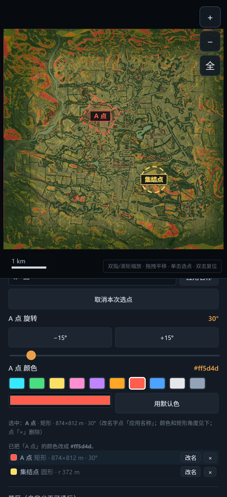

## 角色：载具乘员 / 步兵（0.23.0）

面板最上面是 **角色**，两个按钮：**载具乘员** / **步兵**。选完立刻生效，不用重开地图；当前角色写在
`localStorage['sqrole']`（`veh` / `inf`），下次打开还是它。

**通用模块（两种角色都在，排在最上）**

`查询`、`通视分析（2 km）`、`测距`、`敌情标记 · 图标`、`自由路线 · 标注`、`区域标注 · 圆形 / 矩形`、
`存档 · 导出 / 导入`、`伏击推荐`。

**载具乘员额外显示**

`路线`、`可达区`，以及面板下半部分的载具参数：**载具类别**（陆地 / 两栖 / 水面舰艇 / 直升机）、
**地面载具坡度上限**（含四个预设）、**障碍 · 密林郁闭度阈值**、**参考车速** 与路线结果框。

**步兵额外显示**

`区域入口 · 架枪位`、`最近隐蔽点`、`隐蔽推进 · 沿线射界`、`区域分区 · 观察点`。
载具参数区（类别 / 坡度 / 密林阈值 / 参考车速 / 路线结果框）与 `#heloSec` 一起隐藏。

两组的图例文字会跟着变：选载具时写「载具乘员专用」，选步兵时写「步兵专用」。

实现上**不移动 DOM**，只给按钮一个 `order`（通用 10–18、角色组 29–43），网格按 `order` 排；
切角色时把另一组按钮的 `display` 置 `none`。若当前模式被新角色隐藏（例如载具视角停在「路线」上直接切步兵），
会自动 `setMode('inspect')` 回落到「查询」，并把直升机类别复位成陆地。

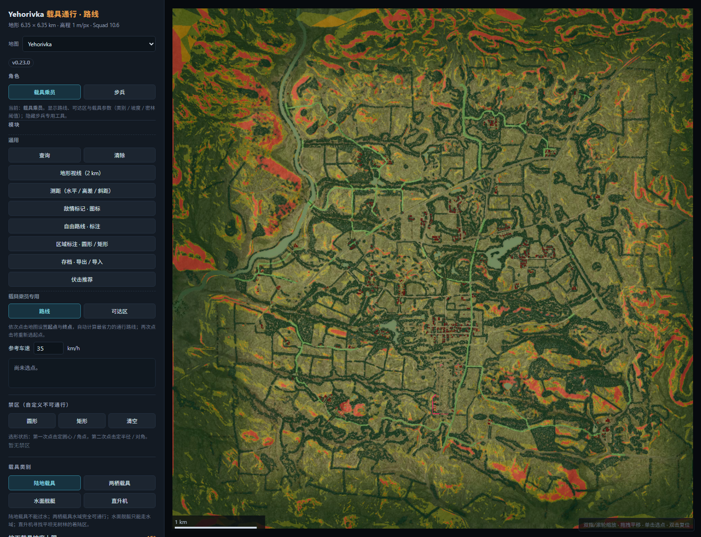

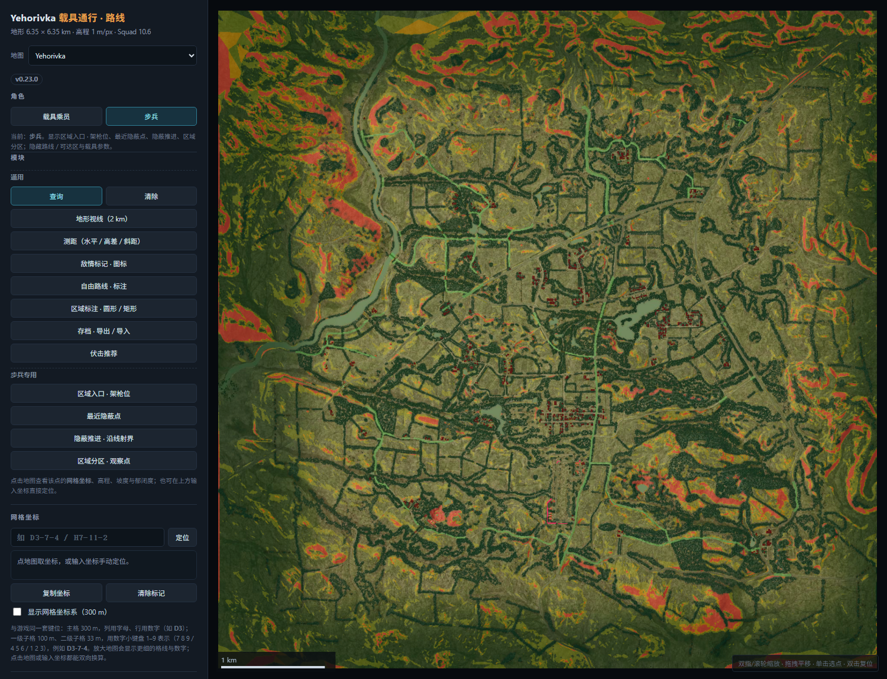

## 文件：新建 / 打开 / 保存 / 另存为（0.24.0）

「文件」栏不再藏在按钮里，它固定在地图选项**上方**，打开地图就能看到：

| 按钮 | 作用 |
| --- | --- |
| **新建** | 清空当前地图的敌情标记 / 自由路线 / 区域标注 / 分析结果，当前文件变成「未命名」（误点可用顶部「撤销」找回） |
| **打开** | 展开本机文件列表（每行带地图名、标记 / 路线 / 区域数、时间），点「打开」载入并把它设为当前文件 |
| **保存** | 覆盖写回当前文件；还没有当前文件时自动转成「另存为」 |
| **另存为** | 用输入框里的文件名新建一份（默认 `文件 N`），并把它设为当前文件 |
| **导出 / 分享** | 导出 `.json`，走系统分享面板发到 QQ / 微信 |
| **从文件导入** | 选一个 `.json` 载入；若它属于另一张地图，会自动切到那张图再导入 |

- 文件名输入框在四个按钮下面（`10 月 23 日进攻路线` 这种就够），保存时留空则沿用原名。
- 当前文件显示在按钮下方：`当前文件：测试文件A · 地图 Yehorivka · 2 标记 / 0 路线 / 1 区域 · 10/23 15:57`。
- 文件名只用于显示，内部 id 是 `A<时间戳>-<随机数>`，同名不会互相覆盖。
- 存储：文件列表 `localStorage['sqarch:<地图文件名>']`（每项 `{ id, name, at, data }`，`data` 就是含 `map` /
  `marks` / `lines` / `regions` / `ana` 的存档对象，最多 60 份），当前文件 id 存
  `localStorage['sqcur:<地图文件名>']`。
- Android 原生通道没变：导出走 `MediaStore` 写「下载 / Yehorivka」再 `ACTION_SEND`，导入走 `ACTION_OPEN_DOCUMENT`
  （读流上限 8 MB）回调 `window.__yhImport`。

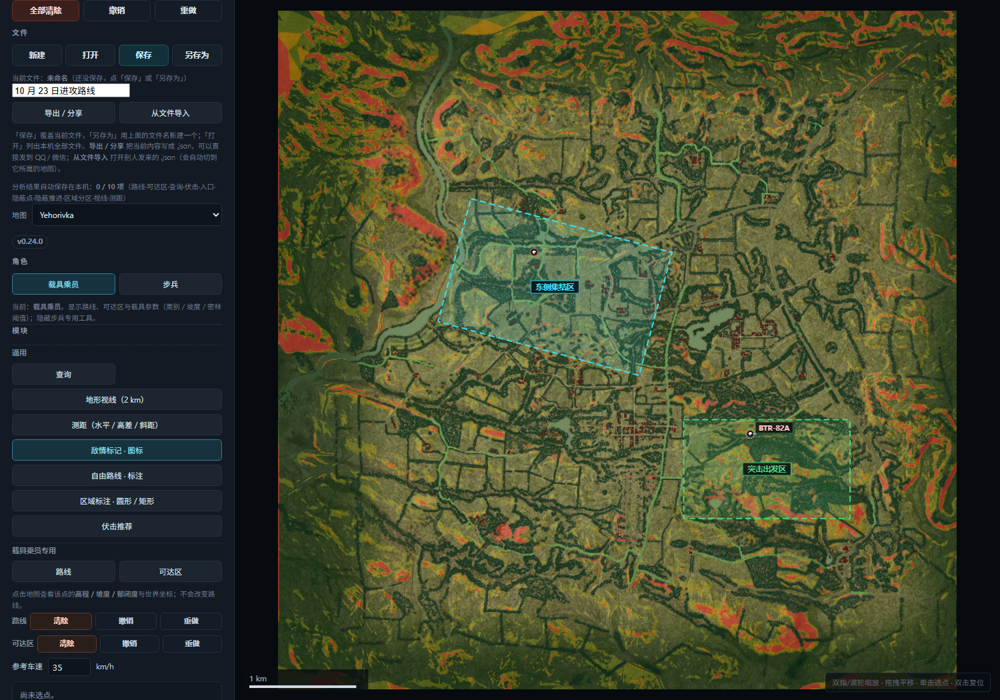

手机竖屏（430 px 宽）同一栏：按钮自动落成 3 列 / 4 列，没有横向溢出。

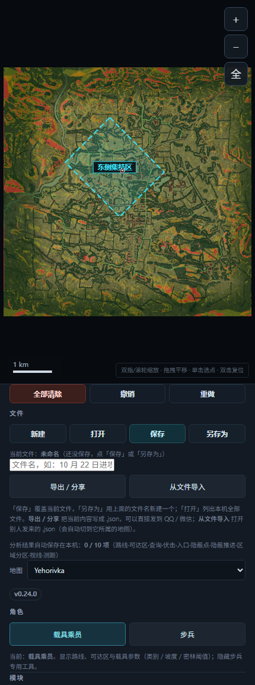

## 每个模块的清除 / 撤销 / 重做（0.24.0）

- **每模块独立**：13 个模块各自有一行 `<模块名> 清除 撤销 重做`——路线、可达区、网格坐标（查询）、测距、
  通视分析、敌情标记、自由路线、区域标注、伏击推荐、区域入口、最近隐蔽点、隐蔽推进、区域分区。
  点某个模块的「清除」只清这个模块，**不会动别的模块**（0.23.0 之前那个混在一起的全局「清除」按钮已删掉）。
- **顶部全局**：文件栏最上面一行是 **全部清除 / 撤销 / 重做**，一次清掉 13 个模块（含分析结果），同样可撤销。
- **撤销粒度**：每 600 ms 采样一次模块状态，连续变化（拖动、连续落点、拖滑杆）会合并成**一步**，
  手停 700 ms 后才记账，所以撤销一次是一个动作而不是一个像素。每模块保留 12–30 步（标记 / 路线 / 区域 30，
  路线 / 可达区 20，其余 12），产生新操作时清空重做栈。
- **恢复内容**：清除 / 撤销会一并恢复模块的 `localStorage`（`sqmarks:` / `sqlines:` / `sqregion:` / `sqana:`）与画面；
  分析类（路线、可达区、视线等）通过 `anaApply()` 重放，可达区还会用 `componentOf()` 重算连通分量。
- 实现：`histSigOf()` 只算轻量签名（长度 + 条数 + 选中项）用来检测变化，`histSnaps()` 才做完整快照
  （一次 `anaCapture()` 出 14 份 JSON），所以空转开销很小。

## 分析结果保存（0.18.0）

「路线」「可达区」「查询」「伏击推荐」「区域入口 · 架枪位」「最近隐蔽点」「隐蔽推进 · 沿线射界」
「区域分区 · 观察点」「通视分析」「测距」——这 10 个工具留下的结果都会**自动存到本机**，
退出 App、换图再回来都还在；也会随「存档 · 导出 / 导入」一起进 JSON。

- 存储：`localStorage` 键 `sqana:<地图文件名>`（每张图一套）。写入有 0.7 s 去抖，
  `draw()` 每帧比对一次签名，只有结果真的变了才写；这项为空时键会被删掉，不留空壳。
- 「存档」区多一行 **分析结果自动保存在本机：N / 10 项**，括号里列出十项名字；N 是当前真有内容的项数。
- **清除本图分析结果**：清空这 10 项与对应存储（敌情标记与自由路线不受影响）。
- 恢复时：可达区用 `componentOf()` 重算掩膜；通视分析重新从高程数据算一遍（约 0.3–1 s，
  期间面板显示“计算中…”）；其余（伏击 / 入口 / 隐蔽点 / 隐蔽推进 / 区域分区）直接把结果对象塞回去，
  再 `renderX()` + `drawX()`；查询只存那个网格点（`kpIdx`），离开“查询”后浮动卡片本就收起，
  地图上的键位十字与绿框照原样恢复。
- 存档 `ver` 升到 **2**，多了 `ana` 字段；`ver:1` 的旧存档仍能导入，只是没有分析结果：

      {"app":"yehorivka-passability","ver":2,"map":"yehorivka",
       "marks":[...], "lines":[...],
       "ana":{"route":{"s":12345,"g":54321,"sn":false,"pts":[...],"r":{...}},
              "reach":{"s":12345,"n":31000},
              "insp":{"i":394752}, "meas":{"s":12345,"g":54321},
              "los":{"i":12345,"e":1.7,"h":true},
              "amb":{"shape":"circle","attack":{...},"safe":{...},"results":[...]},
              "ent":{...}, "hide":{...}, "infil":{...}, "obs":{...}}}

- 存档列表每行也带分析项数：`夜袭路线 A · 10/23 07:57 / 0 标记 · 0 路线 · 8 分析`。
- **路线与可达区互斥**（App 原有行为：点“可达区”会清掉当前路线），所以同一时刻只能存下其中一个；
  两个都要留就分两次存档。
- 区域分区的候选项上挂着 `Uint8Array` 掩膜，序列化前会被剥掉；实测 8 项一共只有 **45 KB**，
  不会撑爆 `localStorage`（一般上限 5 MB）。

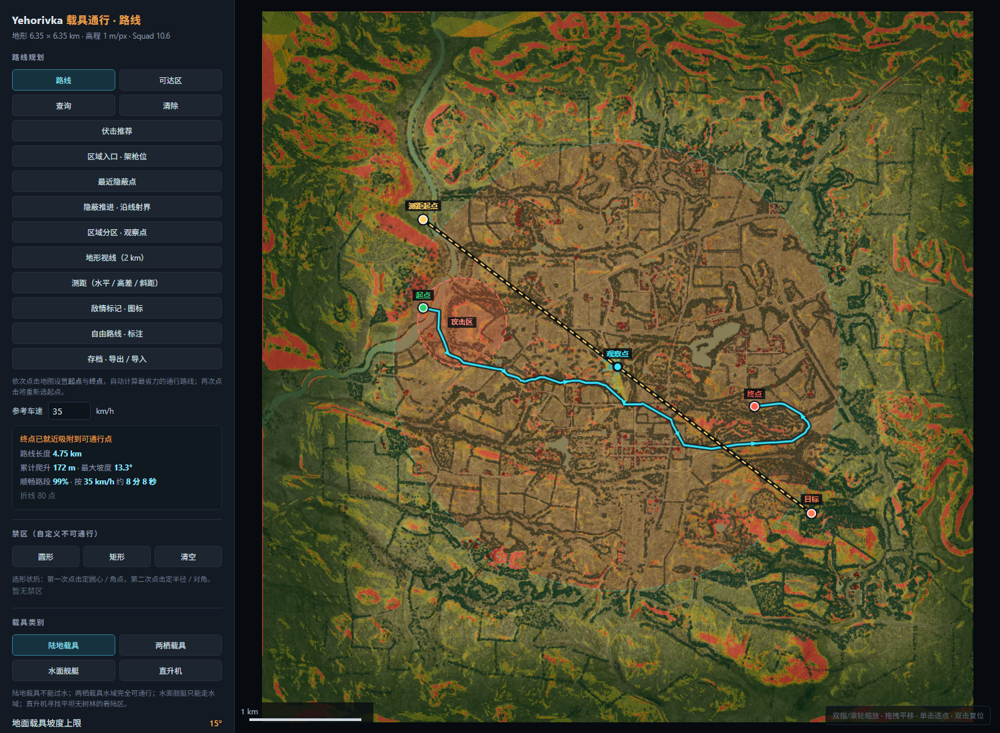

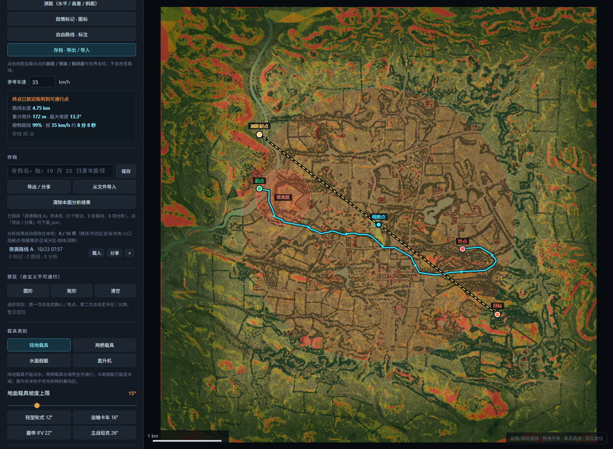

## 离线通视分析（2 km）

点 **通视分析（2 km）**，再点地图选观察点。该模式完全离线，使用本程序内嵌的高程数据：

- **青色**：地面可见
- **黄色**：仅人物高度可见（观察者眼高 1.7 m + 目标人物 1.7 m）
- **红色**：被地形/遮挡物挡住

算法：

- 从观察点眼高（默认 1.7 m，可滑杆调 1–3 m）向四周按 4096 个方位，建立
  “到该距离前的最大地形仰角”；目标地面或人物高度超过这个最大仰角才可见。
- **默认勾选“叠加树林 / 建筑 / 围墙（硬遮挡）”**：密林按当前密林阈值、建筑、
  围墙均作为硬遮挡；道路豁免规则与伏击 LOS 相同。
- **关闭开关**：只算地形高度，便于对比高地/山脊本身的影响。
- 面板统计会显示当前口径（“地形+树林/建筑/围墙”或“仅地形”）。

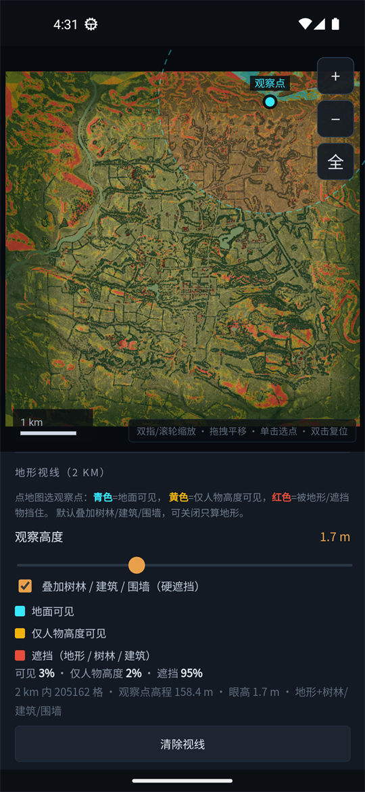

同一观察点实测：

- 开硬遮挡：可见 **3%**、仅人物 **2%**、遮挡 **95%**
- 关硬遮挡：可见 **6%**、仅人物 **5%**、遮挡 **89%**

限制：

- 2 km 内逐格着色；面板显示可见/仅人物/遮挡比例和观察点高程。
- 硬遮挡是栅格近似（4096 个方位 + 密林阈值），不等同游戏内每个树冠/墙件的精确射线。
- APK 无 INTERNET 权限，完全离线。

## 改 HTML / 重建

桌面源文件仍是项目根目录的 `yehorivka-vehicle-passability.html`，它同时是 25 张地图页的模板。
改完根目录 HTML 后运行：

    cd D:\mil-ai
    python tools/build_maps.py

该脚本会给每张地图替换标题、边界、高程范围和六张数据图，再写入
`assets/maps/<slug>.html`。地图选择器现在插在 `<div id="fileBarMount"></div>` **之后**（0.24.0：文件栏在地图选项上方），
模板里没有这个锚点会直接报错退出。只改一张图时用 `python tools/build_maps.py --only narva`。
源数据下载见上节；`tools/sync_mobile_html.py` 已改为调用生成器，保留兼容。

构建：

- Android Studio：打开 `android/YehorivkaMap`，Run / Build APK。
- 本机命令行（在项目根目录）：

      & D:\dsh-data\skills\android-studio\scripts\android.ps1 build `
          -Project D:\mil-ai\android\YehorivkaMap -Task assembleRelease -Variant release

- 输出：`app/build/outputs/apk/release/app-release.apk`

## 结构

    android/YehorivkaMap/
      app/src/main/assets/maps/*.html     25 张地图的独立页面
      app/src/main/java/com/squadmind/yehorivkamap/MainActivity.java
      app/src/main/res/                    WebView 壳 / 图标 / 主题
    tools/maps_catalog.json                官方地图名称 / 边界 / 高度缩放
    tools/download_maps.py                 下载 heightmap / basemap / 3D 实例
    tools/build_maps.py                    生成地图页（Pillow + NumPy）
    docs/yehorivka-mobile.png              伏击推荐截图
    docs/yehorivka-maps.png                多地图选择截图
    docs/yehorivka-albasrah.png            Al Basrah 截图
    docs/yehorivka-water.png               水域/桥梁截图
    docs/yehorivka-heli.png                直升机着陆地截图（0.10.0）
    docs/yehorivka-watercraft.png          水面舰艇航道截图（0.10.0）
    docs/yehorivka-entry.png               区域入口/架枪位截图（0.11.0）
    docs/yehorivka-hide.png                最近隐蔽点截图（0.12.0）
    docs/yehorivka-infil.png               隐蔽推进/沿线射界截图（0.13.0）
    docs/yehorivka-obspoints.png           区域分区/观察点截图（0.14.0）
    docs/yehorivka-grid.png                网格坐标截图（0.15.0）
    docs/yehorivka-los.png                通视分析截图
    docs/yehorivka-mark-grid.png          矢量图标选择器缩略图（0.16.2）
    docs/yehorivka-mark-zoom.png          3× DPR 下的标记清晰度（0.16.2）
    docs/yehorivka-mark-infantry.png      步兵 6 图标 + 头盔标记（0.16.3 修复后）
    docs/yehorivka-route.png              自由路线 / 点备注截图（0.17.0）
    docs/yehorivka-archive.png            存档 / 导出分享截图（0.17.0）
    docs/yehorivka-ana.png                重开地图后分析结果自动恢复（0.18.0）
    docs/yehorivka-ana-archive.png        存档带分析项数 + 清除按钮（0.18.0）
    docs/yehorivka-mark-rotate.png        新建/选择模式 + 旋转 0°/45°/90°（0.19.0）
    docs/yehorivka-mark-status.png        状态（健康/受损/阵亡/摧毁）+ 两条箭头 + 面板（0.20.0）
    docs/yehorivka-mark-status-zoom.png   四种状态的标记放大对照（0.20.0）
    docs/yehorivka-label-arrows.png       自定义标签 + 受损备注在图上 + 路线段方向箭头（0.21.0）
    docs/yehorivka-label-panel.png        标签输入框 + 箭头放置提示 / 虚线预览（0.21.0）
    docs/yehorivka-region.png             圆形 / 矩形区域标注 + 区域名（0.22.0）
    docs/yehorivka-role-veh.png           角色=载具乘员：通用模块置顶 + 载具专用组（0.23.0）
    docs/yehorivka-role-inf.png           角色=步兵：通用模块置顶 + 步兵专用组（0.23.0）
    docs/yehorivka-filebar.png            文件栏（新建/打开/保存/另存为）+ 全部清除 + 每模块条（0.24.0）
    docs/yehorivka-region-rotate.png      区域矩形旋转面板 + 旋转后的矩形（0.24.0）
    docs/yehorivka-filebar-mobile.png     手机竖屏 430 px 下的文件栏 / 模块条（0.24.0）
    docs/yehorivka-region-color.png       区域颜色：10 色色板 + 取色器 + 用默认色（0.25.0）
    docs/yehorivka-hint-026.png           提示条改为「点「全」复位」+ 徽标 v0.26.0（0.26.0）
    android/dist/Yehorivka-Passability-0.26.0.apk

## 验证

- **0.35.0 Squad 官方图标（webp → SVG）+ 官方载具名选择器**：
  - **转换器** `icons/edit_app/webp2svg/webp2svg.py`（v1.0.0，Pillow + numpy + potracer，无外部二进制）：
    `python webp2svg.py "D:\mil-ai\squad-armor\icons" -o "D:\mil-ai\squad-armor\icons-svg"
    --embed-max 1536 --embed-format webp --report … --allow-failures` → **345/379 成功**
    （trace 285 + embed 60），耗时 71.5 s，源 34.4 MB → 20.8 MB；34 个失败全是站点 404 的
    2043 字节 SPA 兜底页（HTML，不是 webp），已用 `meta/icon-paths.json` 反查确认取不到真图。
    trace 模式：alpha 求不透明包围盒 → 2 倍放大再描摹 → 全不透明像素贪心聚色 + 剪掉「夹在两色连线上的
    抗锯齿混色」+ 按占比剪 → 半透明外圈取描边色铺打底轮廓层 → 逐层 potrace 出 `fill-rule="evenodd"`
    的 `<path>`（每层单独一条，与 `markvec.js` 的坑一致）。
  - **入库 242 个 SVG**：23 个兵种（Role Icons 全 trace）+ 218 个武器（Weapon Icons 全 trace）+
    1 个 `T_map_trackedapc_noturret`；复制到 `icons/squad/` 与 `assets/icons/squad/`（各 2.05 MB）。
    重名改名 **1 处**：`rallypoint` → `rallypoint-2`（`tools/gen_squad_icons.py` 里 used 集合查重）。
    Map Icons（40 个整幅小地图，embed 后 27.8 MB）、teamimage（17 个 2048²）、logo 不进 app。
  - **面板**：类别按钮改成 4 列（步兵 / 载具 / 工事 / **武器**）+ 图标搜索框 `#markSearch`；
    点类别实测 **步兵 29 / 载具 90 / 工事 15 / 武器 218 = 352**（0.34.0 是 6 / 89 / 15 = 110）。
    SVG 图标走 ``（`it.sv` → `ICON_DIR + 'squad/' + f + '.svg'`），grid 的
    `object-fit:contain` 直接按原宽高比显示（武器是 2:1）；地图标记的非矢量分支改成按
    `naturalWidth/naturalHeight` 等比缩放（`ar<0.62` 时放宽到 `sz*1.9`），正方形图标缩放与旧行为一致。
  - **官方载具名**：`SQ_VEH` 424 条（来源 `squad-armor/data/Game_vehicles.json`，473 车 / 234 个唯一
    displayName / 20 阵营 / 16 类别），两个下拉（阵营、类别）+ 名称搜索 `#markVehSearch`；
    列表按**只按名称去重**渲染（首版按「阵营|名称」去重会出 M1A1×3、BMP-1×5）；
    点名称写入标记标签（标签上限 24 → **32 字**）；`#markVehName` 只在选中**载具**图标时出现。
  - **Chromium/Edge headless（430×900 @DPR2）实测**：载具名全部阵营 **234** 个按钮、组内 dup=0；
    阵营=USA → 30，USA+MBT → `["M1A2"]`，搜 "btr" → 10 条（BTR-4 / BTR-80 / BTR-82A / BTR-D …）；
    点 BTR-4 → 标签框 "BTR-4"、列表行「主战坦克「BTR-4」· 敌 · K12-2-6」；
    武器类别 218 个、搜 "ak" → 18 个；`file://` 加载 APK 内页面时 218 个 SVG **218/218** 全部
    `naturalWidth>0`（要等 ≥3 s，800 ms 采样会误判成 0/218）。
  - `node --check`（模板内联 `<script>` 3,541,869 字符）通过；`python tools/build_maps.py`
    重生成 25 页 + 0 报错（`yehorivka.html` 3,407,699 字节，含 `id="appVer">v0.35.0`、
    `var SQ_VEH = [`、`icons/squad` 注释）；`versionCode 39` / `0.35.0`，APK
    **55,239,859 字节（52.67 MB）**，SHA256
    `06AE087E9653678056FBE7FDFC27E553CD4F1D973809BE030B600F34F276C735`，解包 entries 499、
    `assets/icons/squad` **242** 个 SVG、`assets/maps` **25** 页。
  - **Android 13 模拟器（AVD `asprobe33`，1080×2340，`-no-window -gpu swiftshader_indirect`）实测**：
    `adb install -r` 成功，`am start` 后无 `FATAL EXCEPTION` / crash 日志，`mCurrentFocus` 落在
    `MainActivity`。用 `adb forward tcp:9222 localabstract:webview_devtools_remote_<pid>` 接管 WebView，
    自写 CDP 客户端（`D:\mil-ai\.tmp\emucdp.js`）在**包内真页面**
    `file:///android_asset/maps/yehorivka.html` 上驱动：
    `#appVer` = `v0.35.0`；点 `#mMark` 面板展开；`#markCatWpn` → **218** 个按钮且
    **218/218 个 SVG `naturalWidth>0`**（`ag36_gl.svg` 214×82、`ak74.svg` 215×59、
    `ag36_whitesmoke.svg` 200×74），搜索 "ak" → 18，控制台无错误；
    用合成 `PointerEvent` 打到 `#cv` 落标记（载具 `AAT_Top`）→ 列表 1 行，
    `#markVehName` `display:block`、**234** 个名称按钮、note「共 234 个名称…」；
    阵营 USA → 30，USA+MBT → `["M1A2"]`，搜 "btr" → 10 条；点 `BTR-82A` →
    标签框 "BTR-82A"、列表行「AAT_Top「BTR-82A」· 敌 · K12-2-6」。
    视觉核对 `docs/yehorivka-squad-icons.png`（武器栏搜 ak 的 18 个白色 2:1 剪影）、
    `docs/yehorivka-squad-vehicles.png`（载具类别 + 图标网格）、
    `docs/yehorivka-veh-picker.png`（阵营/类别下拉 + 搜 btr 的 10 个名称）。
  - **真机仍未验证**（`adb devices` 里只有 emulator，手机没连），触屏手感与真机性能只到模拟器这一级。
  - 踩坑记录：`adb exec-out screencap -p > x.png` **必须用 `cmd /c` 重定向**，PowerShell 的 `>`
    会把二进制写成 UTF-16，得到的 PNG 打不开（`Unsupported or malformed image data`）。

- **0.35.1 两批开发的衔接修补（审计出 4 处，已全部修）**：
  - 兵种图标标签重名 3 组（与原有 icon 撞名，步兵栏出现两个一模一样、tooltip 也相同的按钮）：
    `机枪手` / `轻筒 LAT` / `重筒 HAT` → 新图标分别改成 **机枪手（兵种）** / **轻筒 LAT（兵种）** / **重筒 HAT（兵种）**；
    `tools/gen_squad_icons.py` 的 `ROLE_LABEL` 与模板 `MARK_ICONS` 同步改。
  - `rallypoint-2` 只改了文件名，标签还是 "rallypoint"（与工事里的集结点混淆）→ 改名时标签跟着变
    （`gen_squad_icons.py` 里加 `if label == name: label = new`），模板标签也改成 `rallypoint-2`。
  - **sv 载具图标的「按此图标筛」失效**：`markPanel` 里原写 `markVehIconNow = vIt.sv ? '' : vIt.f`，
    而唯一一个 sv 载具图标 `T_map_trackedapc_noturret` 正好走这条 → 按钮亮着但列表不过滤；
    改成 `markVehIconNow = vIt.f;`。
  - **换图标后筛选状态不重置**：新增 `markVehIconPrev`，图标变化时 `markVehIconOn = false` 再重渲染，
    免得换了个标记还停在上一个图标的筛选结果上。
  - 顺带审计（`D:\mil-ai\.tmp\audit*.js`）：模板 352 条（29/90/15/218，文件名无重复）、242 个 SVG 与
    `icons/squad` / `assets/icons/squad` 一一对应（不缺不多）、无重复函数/变量定义、`SQ_VEH` 424 行的
    icon 全部能在 `MARK_ICONS` 里找到（所以「按此图标筛」对每个载具图标都有效）。
  - **模拟器复验（0.35.1 重装后）**：`#appVer` = `v0.35.1`；步兵栏 29 个按钮 title **无重复**；
    选「履带 APC（无炮塔）」落标记 → 「按此图标筛」→ **1** 个名称（BTR-D）、按钮变「取消图标筛选」；
    改选「主战坦克」再落一个标记 → 自动回到 **234** 个名称且按钮复位（筛选已取消）；
    武器 `ak74` 落标记后**设备截图放大可见白色步枪剪影**（此前只在 Edge 里验过，APK 里没验），
    证据图 `docs/yehorivka-weapon-marker.png`（左：选中的 ak74 武器标记；右：履带 APC 载具标记）——
    注意 CDP `Page.captureScreenshot` 拍不到 canvas 的 GPU 层（截出来是黑的），必须用
    `adb exec-out screencap` + `cmd /c` 重定向。
  - `node --check` 通过；`build_maps.py` 重生成 25 页（`yehorivka wrote 3,407,976`）；
    `versionCode 40` / `0.35.1`，APK **55,242,447 字节**，SHA256
    `E8D22C19BAAEFAB5898E10B8D85736B71CE32C4EF84BD6786665F9966770101C`。
  - **真机仍未验证**（同一轮里 `adb devices` 只有 emulator）。

- **0.36.0 装甲分析器（穿深 / 摧毁方案）**：在「敌情标记」面板里，选一台**有武器的攻击方载具**和一台**目标载具**（目标下拉自动排除攻击方，同一台车不能既当攻击手又当靶子），程序按 Squad 游戏数据算出**打哪个部位、用什么弹、几发能打掉、全命中时最多要多少发**。
  - 数据来自 `D:\mil-ai\squad-armor\data\Game_vehicles.json`（Squad 10.6 的载具导出），`tools/gen_armor_data.py` 生成 `ARM_V` / `ARM_CV` / `ARM_DT` 三个表嵌进页面（**273 台唯一载具、218 台有武器、99,508 字节**）。装甲厚度取 `components.armor[].materials[].overridenThickness`（模型覆盖值优先，空才回退材料默认厚度）。
  - 模型：`单发伤害 = 弹丸当量 × 目标部位伤害修正`；动能弹（`impactDamage = -1`）取伤害曲线枪口值（M256 曲线 8000 → M1A2 打 T-72B3 车体 800/发）；穿深按 61 点曲线随距离衰减（`ARM_SPAN = 1000 m`），只有「能不能穿」看距离，伤害不随距离掉。部位修正表用部件自己的 `damageTypes`，没有就用整车的；表里没有的伤害类别算 0（打不动）。击杀条件：车体 HP 归零或**弹药架 HP 归零**（引擎/履带只作附加信息）。
  - 校验（与社区 HTK 表一致）：M1A2 的 M829A4 → T-72B3 车体 **4 发**、弹药架 **2 发**；M830A1 HEAT → 车体 5 发；M2A3 的 TOW → T-72B3 弹药架 **1 发**（社区「1 HTK on T-72 ammo rack」）；3BM60 → M1A2 车体 4 发。
  - 面板：`#armAtk` / `#armTgt` 两个下拉按**类别分组**（optgroup 中文类别 + 台数）、`#armDist` 距离滑条（0–1000 m，默认 300）、`#armOut` 结果区（最省打法的结论 + 前 6 种可击穿武器，每条列车体/弹药架发数、穿深、备弹、可穿部位）；两个按钮 **「攻击方 ← 选中标记」「目标 ← 选中标记」** 把地图上已写官方名称的标记一键填进选择器，与 0.35.0 的载具名选择器闭环。
  - 模拟器复验（AVD asprobe33，Android 13，重装后）：`#appVer` = `v0.36.0`；面板展开后 `#armAtk` 219 项（218 台 + 占位）/ `#armTgt` 273 项；M1A2 → T-72B3 @300 m 结论「打爆弹药架 2 发即可；全命中时最多需要 4 发（打穿车体）；备弹 21 发，够打完；共 3 种武器能击穿」；M2A3 → T-72B3「TOW 打爆弹药架 1 发，最多 2 发」；地图上放标记 + 载具名写 `M2A3` + 点「目标 ← 选中标记」→ 目标变 `M2A3 · 2000 HP`，攻击方切 BMP-2 →「9M113 Konkurs 打爆弹药架 1 发，最多 2 发」；控制台 clean。
  - 证据图 `docs/yehorivka-armor.png`（左：攻击方/目标选择器；右：穿深与摧毁方案结果）。
  - 说明：未计入入射角、跳弹与未击穿蹭伤，数值是**估算**，面板里也写明了；未列出的部位视为打不到。
  - `node --check` 通过；`build_maps.py` 重生成 25 页（`yehorivka wrote 3,520,149`）；`versionCode 41` / `0.36.0`，APK **55,602,163 字节**，SHA256 `28EE1509225105E887C646A17C1E625BF5226CE271EE032A0CF0B9CF700D760C`；包内 25 页全部带 `#armorSec`。
  - **真机仍未验证**（`adb devices` 里依旧只有 emulator）。

- **0.36.1 一键交换攻击方 / 目标**：「装甲分析」的两个下拉之间加了一个 `⇅ 交换攻击方 / 目标` 按钮（`#armSwap`），点一下攻击方和目标对调，结论区立刻按新方向重算。已选齐两台才可点（未选时置灰），目标若是没有武器的后勤车会提示「没有武器，不能当攻击方」而不交换。
  - 实测（模拟器内）：M1A2 → T-72B3「M829A4 打爆弹药架 2 发 / 最多 4 发」→ 点交换 → T-72B3 → M1A2「9M119M 打爆弹药架 1 发 / 最多 3 发，备弹 2 发不够，需要补给 1 发」→ 再点交换 → 回到原结论；`BMC-185 Logistics` 作目标时交换被拒绝并给提示。
  - `node --check` 通过；`build_maps.py` 重生成 25 页（`yehorivka wrote 3,521,229`）；`versionCode 42` / `0.36.1`，APK **55,608,311 字节**，SHA256 `35609B45240A5724F7C4BAFBEDDD040944C1A7EC0AD063A8E5528B9D82CF4480`；包内 25 页全部带 `#armSwap`，242 个 SVG 图标仍在。
  - 证据图 `docs/yehorivka-armor.png` 已更新（左：两个下拉 + 交换按钮 + 两个「← 选中标记」按钮）。真机仍未验证。

- **0.37.0 重名图标不再跳过（改名并存）**：以前根目录那批官方载具 webp 与 app 里已有图标同名就直接跳过；现在改成**照收 + 改名**，`<name>-2` 追加进「载具」栏，标签加「（新）」后缀区分。
  - 新增 26 个：`T_map_helicopter_lightcas-2` / `T_map_helicopter_scout-2` / `T_map_mgs-2` / `T_map_trackedapc_logistics-2` / `T_map_trackedapc_msv-2`，以及 `map_antiair-2`、`map_apc-2`、`map_attackhelo-2`、`map_boat-2`、`map_ifv-2`、`map_jeep-2`、`map_jeep_antitank-2`、`map_jeep_artillery-2`、`map_jeep_logistics-2`、`map_jeep_transport-2`、`map_jeep_turret-2`、`map_motorcycle-2`、`map_tank-2`、`map_trackedapc-2`、`map_trackedifv-2`、`map_trackedjeep-2`、`map_transporthelo-2`、`map_truck_antiair-2`、`map_truck_logistics-2`、`map_truck_transport-2`、`map_truck_transport_armed-2`。
  - 图标总数 **352 → 378**（步兵 29 / 载具 116 / 工事 15 / 武器 218），`icons/squad` 与 `assets/icons/squad` 各 **268** 个 svg；重名 0、标签重名 0、图标文件缺/多 0。
  - `tools/gen_squad_icons.py` 的 `used` 集合改成只统计内置那批（排除上次插入的 SQ_ICONS 段，否则二次运行会把全部 242 个也当成重名改成 `-2`）；根目录图标走新分支 `elif d == ""`，标签取现有中文名 + 「（新）」。
  - 实测（模拟器内）：`#appVer` = `v0.37.0`；点「载具」→ **116** 个按钮 title 无重复；搜「新」筛出 **26** 个新图标，`map_trackedifv-2.svg` 69×94 与 `map_tank-2.svg` 78×117 都正常加载（26/26）。
  - 证据图 `docs/yehorivka-new-icons.png`（搜「新」后筛出的 26 个重描图标）。
  - `node --check` 通过；`build_maps.py` 重生成 25 页（`yehorivka wrote 3,523,338`）；`versionCode 43` / `0.37.0`，APK **55,640,062 字节**，SHA256 `F706EBF22CB060AAB1321BAFD027313E003BAB5E1D5B24134755E9537EB0DEFF`；包内 525 entries、25 页均 `v0.37.0`、268 个 svg。
  - 仍剩 **34 个 webp 是站点 404 兜底页**（拿不到真图），与本次无关，未变。真机仍未验证。

- **0.38.0 区域标注改成「先起名，再定形状」**：以前是「先点圆形 / 矩形，再写名字点应用名称」，现在反过来 ——
  名字没确认时**不能新建区域**。
  - 面板顺序换掉：#regSec 里 **名字输入框 + 「应用名称」** 挪到 **圆形 / 矩形** 上面，#regShapeRow 在名字行下面；
    两个形状按钮默认带 disabled，CSS `#regSec .presets button:disabled{opacity:.4;cursor:not-allowed}` 让它们看起来就是灰的。
  - 新增 regDraftName（已确认的名字）+ regSetDraft() / regSyncGate()：regApplyName() 确认名字后才解锁形状按钮；
    点形状时若没有名字直接 regShapeHint() 提示；regClick() 第一道判断就是「没确认名字 → 不新建区域」并给出三种不同提示
    （没写字 / 写了没点应用 / 别的地方）。名字画一次就用掉（regSetDraft('')），输入框清空、按钮重新锁上。
  - 改名路径保留：选中某区域后点「应用名称」= 改名；**再点该行取消选中**（regRenderList 里 k0 === regSel 分支），
    否则选中状态下永远无法给新区域起名（自测时踩到，已修）。
  - 提示文案与 setMode('region') 的 modeHint 一起改：名字行「先填区域名并点应用名称确认，形状按钮才会解锁」。
  - 验证（Firefox + Marionette 驱动真实 PointerEvent，与 APK 内页面同一份 HTML）：没起名点圆形 → 无反应；点地图两下 →
    sqregion:* 一个键都没写、提示「先给区域起名…没起名不能新建区域」；空名字点应用名称 → 提示「没有名字不能新建区域」；
    写「A 点」+ 应用名称 → 两个按钮解锁 → 点两下地图 → {"name":"A 点","type":"circle"} 落库、输入框清空、按钮重新锁上；
    只打字不点应用名称就点地图 → 提示「还没确认」且区域数不变；矩形同样走通；选中行改名 → 只是改名，区域数不变。
  - 模拟器实测（AVD asprobe33，重装 0.38.0 后）：#appVer = v0.38.0；面板里名字行在形状按钮上方、两个形状按钮灰；
    点「圆形」无反应；点地图两下 → 提示「先给区域起名：填名字 → 点「应用名称」→ 选形状 → 点地图。没起名不能新建区域。」、仍是「暂无区域」；
    空名字点应用名称 → 「没有名字不能新建区域：先在输入框填区域名，再点「应用名称」。」；
    输入 A1 + 应用名称 → 两个按钮变亮、#regWho 写「下一个区域会命名为 A1」；点地图两下 → 画出圆 A1 · r 2017 m、名字在圆心、
    输入框清空、按钮重新变灰、提示「已添加「A1」（圆形 · r 2017 m）」。
  - node --check 通过；build_maps.py 重生成 25 页（yehorivka wrote 3,526,812）；versionCode 44 / 0.38.0，
    APK **55,666,626 字节**，SHA256 6BBCF89D5CF7F2062E65534430517ABF0F233D7DAF45A3ECEE4CAD65676631A1；
    包内 525 entries、25 页均 v0.38.0 且都带 regSyncGate、268 个 svg 不变。
  - **真机仍未验证**（adb devices 只有 emulator-5554）。

- **0.39.0 地图数据搬上 GitHub，App 里手动下载更新（不用重装）**：25 张图的底图 / 高程 / 坡度 /
  树冠 / 障碍 / 道路 / 旗点打包成 25 个数据包 + 一份 `manifest.json`，放在公开仓库
  **copperbookworm/Yehorivka-MapData**（`maps-data/`，26 个文件共 65,732,978 字节，提交
  `227b3bd1e58ca38508dc5f838a98fb9086fbf9a7`）；raw 基址
  `https://raw.githubusercontent.com/copperbookworm/Yehorivka-MapData/main/maps-data/`。
  - 格式：`{schema:1, slug, name, v, minx, maxx, minz, maxz, lo, hi, img:{14 张图层}, flag_db, flag_cn}`，
    `v` = 不含 v 的序列化内容 sha256 前 12 位（本图 `8b23709cd41c`，2,843,595 字节）；
    `manifest.json` = `{schema, updated, base, builtin:{slug:v}, maps:{slug:{name,v,size,sha256}}}`，
    本图 sha256 `5dd934d389fb212d7e14f4b54cb5eab82046aadee7d7accaa81411ca6f9f92e8`。
  - 页面：新增 **地图数据 · 在线更新** 面板（`#mdataStat/#mdataBase/#mdataCheck/#mdataDl/#mdataDlAll/#mdataDel`）；
    启动时 `MAP_PACK = YehorivkaBridge.mapPackGet(MAP_SLUG)`（没有桥就退回 `localStorage['mappack:<slug>']`），
    有本机包就覆盖 `MINX/MAXX/MINZ/MAXZ`、`ELEV_LO/HI`、14 个 `IMG_*` 与 `FLAG_DB/FLAG_CN`；
    `MAP_FILE` 改成 `MAP_SLUG`；`MAP_DATA_V` 由构建脚本注入，用来比「内置版本 / 本机版本 / 远端版本」。
  - 原生：`AndroidManifest.xml` 加 `<uses-permission android:name="android.permission.INTERNET"/>`
    （0.38.0 及以前完全没有网络权限）；`ArchiveBridge` 新增 `mapPackGet/mapPackInfo/mapPackList/
    mapPackDelete/mapPackDownload/netGet`，后台线程下载 + 边下边算 SHA-256，大小 / 哈希都对上才原子替换，
    包存 `getFilesDir()/maps/<slug>.json`、索引 `index.json`（与包同目录）；上限 24 MB/包、2 MB/清单。
  - 构建：`tools/build_maps.py` 生成页面的同时写 `dist/maps-data/<slug>.json` 并合并 `manifest.json`；
    全量跑一次得到 25 页 + 26 个 json。
  - 验证：从 GitHub raw 直接拉 manifest 与 3 个包，字节数与 sha256 **全部与清单一致**；
    Firefox（`file://` 打开生成页）点「检查更新」→「远端版 8b23709cd41c（2.7 MB）· 已是最新」；
    另用「底座层换成品红图」的变体包验证过**下载后地图真的按本机包重绘**。
  - 模拟器实测（AVD asprobe33，重装 0.39.0 后）：`#appVer` = v0.39.0、`versionCode` 45 / `versionName` 0.39.0；
    面板显示「原生桥已就绪」→ **检查更新** → 「远端版 8b23709cd41c（2.7 MB）· 已是最新」「已读到远端清单（2026-10-27）」；
    **下载本图** → 「正在下载 yehorivka（1/1，2.7 MB）」→ 自动重载 → 「本机已下载 8b23709cd41c（2.7 MB）· **正在用它**」、
    「本机已下载 1 张，共 2.7 MB」；logcat 有 `YehorivkaMap: pack saved yehorivka 2843595 bytes v=8b23709cd41c`（字节数与远端包完全一致）；
    **删除本图数据** → 重载 → 回到「本机没下载 · 正在用安装包内置数据」「0 张，共 0 B」；全程无 `FATAL EXCEPTION` / ANR。
  - node --check 通过（js 3,617,021 字符）；build_maps.py 重生成 25 页（yehorivka wrote 3,541,875）；
    包内 25 页 `MAP_DATA_V` 与 manifest 逐一对齐（25/25）、都带新面板与更新模块（25/25）；
    versionCode 45 / 0.39.0，APK **55,793,382 字节**，SHA256
    `4C97778EB7CB09D0B4A500503459A7652D4DEBE95EFAB04A6184D18FE9CA6C99`。
  - **真机仍未验证**（adb devices 只有 emulator-5554）。

- **0.40.0 主基地部队编成（敌情标记里选阵营 / 对局类型 / 具体部队）**：数据来自 SquadCalc 的 layer 单位表
  （`D:\mil-ai\SquadCalc_res\layers\vanilla`，206 个 layer JSON：载具数量 / 延迟 / 重生 / 票值 / 座位）与
  squad-armor 的 faction setup（人员名额、工事、指挥官技能），合并成 **267 条编制**（250 个可选具体部队 +
  17 个 `*_FSTemplate` 阵营模板，模板不显示），全部内嵌进页面 `var SQ_UNIT`，运行时不联网。
  - 同名同延迟同重生的载具行 **合并数量**（49 处），避免出现两行同名车；载具按 **延迟升序 → 数量降序 → 名称** 排。
  - 中文化在数据层烘好：车型 17 / 兵种 28 / 指挥官技能 16 / 工事 70 / 类别 3 / 特性 21；曾因两条 key 带尾空格
    （`"2 Mortars avaliable per FOB "` / `"-1 Mortar avaliable per FOB "`）替换未命中，改成 JSON.parse 后按 key 替换修好。
  - 验证：Firefox 打开模板页与生成页，`#appVer` = v0.40.0、17 个阵营、切阵营 / 对局类型 / 部队后 `#buOut` 立即重渲染、
    console 0 条报错；**250 个部队逐个 change 渲染，0 空面板 0 异常**（2.0 s）；
    抽查 RGF_LO_Support 与原始 layer 一致；USA 1st Infantry Division 11 种车（8 种开局可用，M1A2 延迟 15 分、
    M939 Transport 与 UH-60M 延迟 6 分）。
  - 包内校验：`assets/maps` 25 页 **全部** 含 `var SQ_UNIT` / `id="buSec"` / `v0.40.0`，0 页遗漏；
    versionCode 46 / 0.40.0，APK **56,453,770 字节**，SHA256
    `C77B93DE38D67CCEEAE6D287F7741D071177DFF653F8F9C3CBB22E7BE7C14F53`。**真机未验证**。

- **0.41.0 对局规模跟着「旗点 · 占领区」自动判定**：面板不再让玩家自己选大图 / 中图 / 小图。
  - 新增 `BU_LSZ`（**196 条** layer → 规模，由 206 个 layer 的 unit 后缀统计；10 个只有 `*_FSTemplate` 的 layer 不入表）
    与 `buLayerSize / buVarsForSize / buPickVar / buHintHtml / buSyncFromFlag / buHookFlag`；
    `buHookFlag()` 把 `flagSyncLayer` / `flagSetLayer` 各包一层回调（flagInit 在 IIFE 末尾执行，早于此的 buInit 拿不到 layer）。
  - **只有 Invasion 的大图 / 中图才分进攻方（LO/MO）与防守方（LD/MD）**；AAS / RAAS 两队编成相同，忽略攻守偏好
    （第一版没这限制，Sumari 小图被错选成「小图 · 遭遇战」）。手动改对局类型即转手动模式，提示行给「恢复跟随」。
  - 覆盖度：25 页 FLAG_DB 键并集 **127 条全部命中 BU_LSZ**（L 97 / M 22 / S 8）；只有 `jensen.html` 的 FLAG_DB 是空对象
    （SquadCalc 无 Jensen 图层），走「本图无旗点数据 · 无法自动判定对局规模」提示。
  - 浏览器实测（file:// 打开生成页，dispatch change）：yehorivka 切 `Yehorivka_AAS_v2` / `Yehorivka_Invasion_v1`
    后提示「旗点 Invasion · 大图 → 已自动选「大图 · 进攻方」」、`#buVar`=LO、unit=`ADF_LO_Mechanized`，console 0 条；
    sumari 自动选 S（`ADF_S_CombinedArms`）；harju AAS_v1→LO / AAS_v2→MO / RAAS_v3_CL→MO / Invasion_v1→LO 带攻守注解；
    jensen 提示「本图无旗点数据 · 无法自动判定对局规模，请手动选大图 / 中图 / 小图」；「关闭跟随 / 恢复跟随」可切换。
  - `python tools/build_maps.py` 全量重建 25 页耗时 **124 s**；Gradle（**JDK 17**）BUILD SUCCESSFUL in 22s；
    versionCode 47 / versionName 0.41.0（aapt2 dump badging 核对），APK **56,525,242 字节（53.91 MB）**，SHA256
    `FFF007A3857BE17B8B6FF49FDAD50F7F183C289F8FF4DDF87A449CB9077089C8`；
    包内 25 页全部含 `var BU_LSZ =` / `id="buAuto"` / `v0.41.0`（0 页缺失）。**真机未验证**。

- **0.42.0 查询点坡度箭头（可关）**：
  - 新增 `hAtM(mx, mz)`（双线性高程采样，`fx = mx / CELLX - 0.5` 取格心）与
    `kpSlopeAt(mx, mz)`：以标记点为中心、`KP_SLOPE_R = 4` 格（约 ±25 m）窗口做**最小二乘平面拟合**，
    窗口对称 ⇒ `gx = sx / sxx`、`gz = sz / szz`，下坡方向 `ux = -gx`、`uz = -gz` 归一化；
    结果按 (x,z) 缓存，draw 每帧调用不重算。
  - 画法：起点半径 9 px、长 30 px，`#ffb86b` 主体（线宽 2.2）+ `rgba(6,12,18,.92)` 深色衬底（线宽 5）
    与放大 1.45 倍的衬底箭头（`arrowHead(k)` 闭包），任何底图都看得清；衬底最初给 1.9 倍，
    在橄榄绿底图上显得头重脚轻，改到 1.45。
  - 与标签冲突：坐标标签原本画在 `py - 17`，正好压在朝上的箭头上（实测箭头被标签挡住只剩 18 px 露头）；
    现在 `kpArrowUp = az < -0.3` 时标签改画到 `py + 36`（标记点下方）。
  - 开关：`#tSlope`（`显示坡度箭头（指向下坡最快方向）`，默认 checked），`setSlopeArrow(on)` 写
    `localStorage['sqslope:' + MAP_FILE]`（按地图记忆），初始化时读回。
  - **独立核对**：把模板里的 `IMG_ELEV`（1024×1024 PNG，`ELEV_LO 0 / ELEV_HI 247.8`）导出，用 Python + Pillow
    重写一遍采样与拟合，在 (2783.33, 3183.33) 处得到 `ux=0.091243 uz=-0.995829 deg=4.617`，
    与页面内计算 `0.09124287636053281 / -0.9958286687545486 / 4.617032707212247` **完全一致**。
  - 方位角核对（读 canvas 像素，连通域 107 px 做 PCA 求轴、按宽度判箭头端，与算法方向比）：
    `D3 71.6°/71.4°`、`Q4 -179.5°/-178.8°`、`B15 112.4°/112.4°`、`L6 -123.0°/-123.1°`、
    `O16 81.3°/81.5°`、`M12 33.9°/33.8°`、`J11-4-3 -84.5°/-84.8°` —— **最大偏差 0.69°**。
  - 开关实测：勾掉后琥珀色像素 109 → 2（只剩底图噪点），勾回 109；关掉后重载页面 checkbox 仍为关、箭头不画。
  - sumari（沙色等高线底图）C3 / A1 处同样画出 107 px 箭头，console 0 条。
  - `python tools/build_maps.py` 重建 25 页；Gradle（JDK 17）BUILD SUCCESSFUL in 26s；
    versionCode 48 / versionName 0.42.0（aapt2 核对），APK **56,568,430 字节（53.95 MB）**，SHA256
    `CA06B25F5EC96364F1A3E4F5200DC36F98A5C3DAC1E13AB7F42C455F6B89DBD6`；
    包内 25 页全部含 `id="tSlope"` / `kpArrowUp` / `v0.42.0`（0 页缺失）。**真机未验证**。

- **0.43.0 右侧「查询 / 测距」按钮 + 查询对话框 + 更快的自动下滑**：
  - 右侧按钮挂在原 `#zoomCtl`（`position:absolute; right:12px; top:12px; flex-direction:column; gap:6px; z-index:6`，
    40×40 圆角）里，`zTopo` 之后加 `<div class="zSep">` 分隔线 + `#qInspect`（`查`）+ `#qMeasure`（`距`）；
    `ICON_OF` 加 `qInspect:'locate'` / `qMeasure:'ruler'`，`ICON_ONLY` 加这两个键 → 文字被 SVG 图标替换、
    保留 `aria-label`；可见性沿用放大键那条 `@media (max-width:880px),(pointer:coarse)`。
    `setMode()` 里同步给这两个按钮切 `.on`（青边高亮）。
  - 对话框 `#kpDlg`（`.dlgWrap` 全屏 `rgba(4,7,10,.62)` / `.dlgBox` `94vw`、`max-width:360px`、z-index 40）：
    标题「查询坐标」+ ✕、`#kpDlgIn` 输入框、`#kpDlgGo` 定位、`#kpDlgOut` 结果区、`#kpDlgPick` 在地图上点选、`#kpDlgClose`。
    按钮都带 `data-ic="skip"`，避免被 `iconsApply()` 自动塞图标。
  - 逻辑：`kpDlgGo()` 先用现成的 `kpParse()` 校验（失败只红字提示「坐标格式不对」），成功则把文本写回 `#kpInput`、
    `setMode('inspect')`、调原 `kpLocate()`（保持 kpFocus / kpHold / 别名回显那套行为），再把 `#kpOut.innerHTML`
    搬进对话框；`kpDlgPickMode()` 关框、置 `kpPickPending = true`、改 `#modeHint`；`showInspect()` 末尾检测
    `kpPickPending` → 自动 `kpDlgResult(tip.innerHTML)` 把结果框弹回来。输入框支持回车（`key==='Enter'||keyCode===13`），
    点遮罩空白处关闭。左侧模块列表的 `#mInspect` 也调用 `kpDlgOpen()`，与右侧按钮一致。
  - 提速：`fastScroll(el, ms)` 先算 `top = el.rect.top - panelScroll.rect.top + panelScroll.scrollTop - 6`，clamp 到
    `[0, scrollHeight-clientHeight]`，再按 140 ms 三次缓出逐帧写 `scrollTop`（`rAF` + `cAF`，同一时刻只跑一个动画）；
    面板不可滚动时回退 `el.scrollIntoView({block:'start'})`。原先 15 处
    `setTimeout(…80)` + `scrollIntoView({block:'start',behavior:'smooth'})` 全部替换为
    `rAF(function(){ fastScroll(document.getElementById('…')); })`（替换后旧写法残留 0 处）。
  - **实测（Firefox，视口 500×795 的触屏布局，`#panelScroll` 349 px 高）**：
    - 同一段 1290 px 滑动：原生 `scrollIntoView({behavior:'smooth'})` **613 ms**（84 帧），
      `fastScroll` **121 ms**（25 帧）——约 5 倍；且不再有原来那 80 ms 空等。
    - 逐个点 16 个模块按钮（路线 / 可达区 / 伏击 / 火力支援 / 旗点 / 沿线通视 / 通视 / 测距 / 区域入口 /
      最近隐蔽点 / 隐蔽推进 / 区域分区 / 敌情标记 / 自由路线 / 区域标注 / 查询）：目标区块 `rect.top - 面板 top` 稳定为
      **6 px**（路线与可达区共用 `#routeExtra`，本身就在面板顶部，滚动量为 0 属正常），console **0 条**。
    - 点右侧「查询」（`#qInspect`）：`#kpDlg` 变 `display:flex`，输入框自动带出上次坐标并聚焦；
      输入 `H7-11-2` 点「定位」→ 结果框「H7-7-2 ｜ =H7-11-2 ｜ 树线 ｜ 高程 108.8 m · 坡度 4.3° ｜ 开阔地 ｜
      X -1153 / Z -1420 m」，`#kpOut` 同步、`#kpInput` = `H7-11-2`。
    - 点「在地图上点选」→ 框关闭、`#modeHint` 改为「点地图任意位置…查完弹出结果」；随后向 `#cv`
      dispatch `pointerdown(buttons:1)` + `pointerup`（画布 42% / 55% 处）→ 结果框**自动弹回**并显示
      「G7-5-2 可行 高程 84.5 m · 坡度 9.7° 开阔地 X -1358 / Z -1302 m」。
    - 生成页 `sumari.html` 复测：`#appVer` = `v0.43.0`、`#zoomCtl` display flex、对话框输入 `C3-7-5` →
      「C3-7-5 顺畅 高程 0.0 m · 坡度 0.0° 开阔地 X 11 / Z 204 m」、`#kpSec` 与 `#measureSec` 均贴顶 6 px、console 0 条。
  - `python tools/build_maps.py` 重建 25 页（`manifest 5212 bytes, 25 maps`）；Gradle（JDK 17）
    **BUILD SUCCESSFUL in 43s**；versionCode **49** / versionName **0.43.0**（aapt2 dump badging 核对：
    `package: name='com.squadmind.yehorivkamap' versionCode='49' versionName='0.43.0' compileSdkVersion='35'`），
    APK **56,614,242 字节（53.99 MB）**，SHA256
    `96EB1962EEE7084836938219D955333570A7F89E72A2775FBE5D6E18D22DAA83`；
    包内 25 页全部含 `id="kpDlg"` / `id="qInspect"` / `function fastScroll` / `v0.43.0`（0 页缺失）。**真机未验证**。

- **0.43.1「显示网格坐标系」复选框失效修复**：
  - 根因：`drawKP()` 由 `if (state.kpOn || state.kpIdx >= 0)` 调用，函数体内网格线（`grid()` 两次 + 100 m / 33 m
    细线）、方格字母 / 行号（`if (kx >= 30) … else …` 两分支）、100 m 子格数字（`if (kx / 3 >= 30)`）、
    高亮绿框（`if (state.kpIdx >= 0)` 里那段 `strokeRect`）**都没有看 `state.kpOn`**，取消勾选只改状态不改绘制。
  - 修法：这四段各自包进 `if (state.kpOn) { … }`（标签两分支改成 `if (state.kpOn && kx >= 30) … else if (state.kpOn)`），
    十字标记、坐标标签、坡度箭头留在 `if (state.kpIdx >= 0)` 原处不受影响。
  - 语义与记忆：`state.kpUserGrid`（null/true/false）+ `localStorage['sqkp:<slug>']`；`kpGridAutoOn()` 只在
    「玩家没手动关过」时把网格打开，`kpLocate()` 与 `showInspect()` 都改调它，`#tKP` 的 change 处理器写记忆。
  - **实测（Firefox，模板页 yehorivka，画布 1143×975，`getImageData` 统计近中性亮像素 / 标记绿 / 箭头的琥珀）**：
    - 定位 `J11-4-3` 后勾选态：light **18899**、green **593**（含 300 m 高亮绿框）、amber **104**；
    - 取消勾选（`#tKP` change）：light **964**、green **108**（只剩十字 + 圆点）、amber **104**（箭头照画）；
    - 再勾上：light 回到 **18899**、green 593，`localStorage['sqkp:yehorivka-vehicle-passability'] = "1"`；
    - 关掉后重载页面：存储为 `"0"`、复选框未勾，此时点「定位」`H7-11-2` → light 仍 **964**、green 127、
      复选框仍不勾（说明「手动关过」的选择被尊重，不再被查点强行打开）；
    - 清空存储后重载：无记录、复选框未勾，第一次定位 `D3-7-4` → 复选框自动勾上、light **10525**（此时已放大到
      该点，可见格数变少故比 18899 小）；
    - 「在地图上点选」流程（网格已关）：向 `#cv` dispatch `pointerdown(buttons:1)` + `pointerup`（62% / 42% 处）→
      对话框自动弹回「F2-8-5 顺畅 高程 70.0 m · 坡度 3.3° 开阔地 X -1649 / Z -2952 m」，light 前后都是 964（网格未复活）；
    - 全程 console **0 条**；截图对比确认关时无格线、开时格线与字母行号齐全。
  - `python tools/build_maps.py` 重建 25 页（`manifest 5212 bytes, 25 maps`），25 页全部含 `state.kpUserGrid` /
    `kpGridAutoOn` / `v0.43.1`（0 页缺失）；Gradle（JDK 17）**BUILD SUCCESSFUL in 8s**；
    versionCode **50** / versionName **0.43.1**（aapt2：`package: name='com.squadmind.yehorivkamap' versionCode='50'
    versionName='0.43.1' compileSdkVersion='35'`），APK **56,627,498 字节（54.00 MB）**，SHA256
    `A18D745CCF0F7CB1FFDA17318BBB0A452EAD3A8CA88E927DEF27AAC3A716BBD9`；解包 python zipfile 核对 25 页均含三个标记
    （bad `[]`）。**真机未验证**。

- **0.43.2 查询对话框按钮改名 + 手指图标**：
  - 改动：`#kpDlgPick` 文本「在地图上点选」→「点地图得坐标」，去掉 `data-ic="skip"` 让 `iconsApply()` 自动插入
    `ICON_SVG.fingerTap`（Material `touch_app`，路径 `M9 11.24V7.5C9 6.12 10.12 5 11.5 5S14 6.12 14 7.5v3.74c1.21-.81 2-2.18 2-3.74…`，
    `fill="currentColor" stroke="none"`），`ICON_OF` 加 `kpDlgPick: 'fingerTap'`；`.dlgBtns button > svg.ic` 放大到 17 px。
  - 图标选型：先试了 5 个自绘描边手指，15 px 下全糊成黑块；单指竖起的实心手形容易被读成「竖中指」，弃用；
    最终用 Material `touch_app`（食指 + 掌心 + 触点），5 倍最近邻裁切（`D:\mil-ai\.tmp\dlgbtn_crop.png`）目视确认 17 px 可辨。
  - Firefox 实测（视口 500×800，模板页）：`#appVer` = `v0.43.2`；`#kpDlgPick` 文本「点地图得坐标」、
    `data-ic="fingerTap"`、`svg.ic` 实测宽 **17 px**；默认提示同步为「…也可以点「点地图得坐标」…」。
  - 流程复测：点该按钮 → `#kpDlg` 关闭、`#modeHint` =「点地图任意位置，查出该点的网格坐标 / 高程 / 坡度…」；
    向 `#cv` dispatch `pointerdown(buttons:1)`+`pointerup`（55%/45%）→ 对话框自动弹回
    「M10-4-4 顺畅 高程 118.6 m · 坡度 1.0° 开阔地 X 304 / Z -453 m」。全程 console **0 条**。
  - `python tools/build_maps.py` 重建 25 页（`manifest 5212 bytes, 25 maps`），25 页全部含
    `<button id="kpDlgPick">` / `fingerTap` / `点地图得坐标` / `v0.43.2`，且无 `data-ic="skip"` 残留（bad `[]`）；
    Gradle（JDK 17）**BUILD SUCCESSFUL in 19s**；versionCode **51** / versionName **0.43.2**
    （aapt2：`package: name='com.squadmind.yehorivkamap' versionCode='51' versionName='0.43.2' compileSdkVersion='35'`），
    APK **56,634,962 字节（54.01 MB）**，SHA256 `4DFE03C64B9B0CA642D3B324DBEBEFFD31BE16689DB184417E7B02405CADBCFB`；
    解包 python zipfile 核对 25 页均含四个标记（bad `[]`）。**真机未验证**。

- **0.43.3 非法坐标拒绝**：
  - 改动：删掉 `kpParse()` 的两位数字分支与其注释、删掉只为两位写法服务的 `kpSegText()` 与回显 alias 逻辑；
    子格段改判 `/^0*[1-9]$/`（只认 1–9，允许补零），失败原因写进模块变量 `kpParseErr`，
    `kpLocate()` 与 `kpDlgGo()` 都改成「这个坐标不合法 + 具体原因 + 写法示例」。
    `kpParse()` 现在多返回 `depth`，`kpLocate()` 用 `pos.depth` 取标签深度。
  - Firefox 实测（模板页，v0.43.3，逐条点「定位」读 `#kpOut`）：
    `G10-3-12` → 「…二级子格只能填 1–9 中的一个数字…「12」不合法」；`G10-3-0`、`G10-3-33` 同段报错；
    `H7-11-2` → 「一级子格…「11」不合法」；`D3-7-4-1` → 「最多两级子格」；`ZZ99` → 「主格 ZZ99 不在这张地图上」；
    `J25-1` → 「主格 J25 不在这张地图上」；`G10-3-4` → 正常 `高程 112.7 m · 坡度 14.3° X -1283 / Z -353 m`；
    `D3`、`D3-7`、`D3-7-4`、`d3-7-4`、`D03-07-04`、`D3 7 4` 全部正确定位（后者标签显示 `D3-7-4`）。
  - 对话框路径：输 `G10-3-12` 点「定位」→ 框保持打开、结果区报同一原因，`#kpInput` 仍是上一个合法坐标
    `G10-3-4`（不覆盖旧标记）；随后输 `G10-3-4` 正常出结果。全程 console **0 条**。
  - `python tools/build_maps.py` 重建 25 页（`manifest 5212 bytes, 25 maps`），25 页全部含
    `kpParseErr` / `pos.depth` / `v0.43.3` 且不再含 `kpSegText`（bad `[]`）；Gradle（JDK 17）
    **BUILD SUCCESSFUL in 18s**；versionCode **52** / versionName **0.43.3**
    （aapt2：`package: name='com.squadmind.yehorivkamap' versionCode='52' versionName='0.43.3' compileSdkVersion='35'`），
    APK **56,642,238 字节（54.02 MB）**，SHA256 `5C6AC0B84AE5CAAAEE5FD2F3CEC9AFE9CAAE34EFC8DF5A5E0583F3B2AD2EDAEA`；
    解包核对 25 页同四个标记（bad `[]`）。**真机未验证**。

- **0.43.4 通视分析挪到地图右侧**：
  - 改动：`#zoomCtl` 在 `#qMeasure` 之后加 `<button id="qLos" aria-label="通视分析" title="通视分析（2 km）">视</button>`；
    `ICON_OF` 加 `qLos: 'eye'`、`ICON_ONLY` 加 `qLos: 1`（渲染成 SVG 眼睛，与放大键那排同款）；
    `kpDlgInit()` 里绑定 `#qLos` → `setMode('los')` + `fastScroll(#losSec, 120)`；
    `setMode()` 里加 `_ql.classList.toggle('on', m === 'los')` 与面板 `#mLos` 同步高亮。
  - Firefox 实测（视口 500×800，模板页 v0.43.4）：`#zoomCtl` display **flex**，7 个子元素
    `zIn/zOut/zFit/zTopo/zSep/qInspect/qMeasure/qLos` 全部渲染为 svg，`#qLos` 实测 **40×40**；
    点它 → `#losSec` display **block**、`#qLos` 带 `.on`、`#panelScroll` 滚到 `scrollTop 1290`、
    `#losSec` 距面板顶 **6 px**、提示行切到「点地图选观察点做通视分析，显示 2 km 内的可…」；截图确认眼睛按钮高亮。
  - 互斥检查：点「测距」→ `#qLos` 的 `.on` 变 false；点面板「通视分析」→ 又变 true；
    点面板「查询」→ 变 false（高亮始终只跟着当前模块）。
  - `python tools/build_maps.py` 重建 25 页（`manifest 5212 bytes, 25 maps`），25 页全部含
    `id="qLos"` / `qLos: 'eye'` / `v0.43.4`（bad `[]`）；Gradle（JDK 17）**BUILD SUCCESSFUL in 19s**；
    versionCode **53** / versionName **0.43.4**（aapt2：`package: name='com.squadmind.yehorivkamap'
    versionCode='53' versionName='0.43.4' compileSdkVersion='35'`），APK **56,644,206 字节（54.02 MB）**，
    SHA256 `AF82922669A123BF68D990B8145B6A3329A21348DD51E73C62156E1847872D5D`；
    解包 python zipfile 核对 25 页均含三个标记（bad `[]`）。**真机未验证**。

- Android 13 模拟器（sdk_gphone64_x86_64，1080×2340）：
  - install + launch 成功，无 `FATAL EXCEPTION` / ANR。
  - **地图切换**：下拉列出 25 张官方图；Yehorivka → Al Basrah 整页加载成功；
    返回键回 Yehorivka，选择器通过 `pageshow` 同步回 Yehorivka。
  - **Al Basrah 路线规划**：起点/终点、A*、蓝色路线正常；底图/高程/坡度/树冠/
    建筑/围墙/道路均来自该图自己的 1024 网格。
  - **水域/桥梁**：Al Basrah 水面显示蓝色遮罩；点击河心设置起点，标记自动落到最近岸/桥，
    没有留在水里；桥面在 `classify()` 中优先于水面和障碍。
  - **0.10.0 载具类别**：Yehorivka 切“直升机”后显示绿色可着陆像素、A–E 五个候选、
    “可着陆 27.8% · 11.19 km² / 候选区 5 块”；Narva 切“水面舰艇”后仅水域高亮，
    陆地变暗，说明按当前类别重算生效。
  - **0.11.0 区域入口 · 架枪位**：Yehorivka 圈半径约 470 m 的圆形区域后显示
    “边界入口 6 个 · 架枪位 11 个”；A 入口 3 个架枪位（P1 40 分 / 342 m / 射界 85%
    / 草丛，P2、P3 开阔地）；A–F 与 P1–P3 标记、连线、射界锥均正常，无崩溃。
  - **0.12.0 最近隐蔽点**：Yehorivka 点“最近隐蔽点”后在地图中心设起点，600 m 内 7335 个候选，
    选中“隐蔽度 80 · 距起点 20 m · 密林”（树冠 64%、低洼 −0.3 m、坡度 2°、周边较高 6%）；
    紫色搜索圈、起点“起”、结果“H”与偏移引线均正常，无崩溃。
  - **0.13.0 隐蔽推进 · 沿线射界**：Yehorivka 设区域外集结点并圈圆形区域后显示
    “路线 0.99 km · 平均隐蔽 59 · 密林 92% · 威胁覆盖 7% / 威胁架枪位 3 个 · 步兵约 15 分”；
    T1 34 分（230 m、射界 7%、树林、树冠 64%），T2/T3 为开阔地；路线分段、集/入标记、
    T1–T3 与射界锥均正常，无崩溃。桌面 headless 另测 1.55 km / 隐蔽 57 / 密林 83% / 覆盖 14% / 5 个架枪位。
  - **0.14.0 区域分区 · 观察点**：Yehorivka 圈圆形区域后显示
    “分区 5 块 · 观察点 22 个 · 可观察 83% / 面积 0.29 km² · 采样 358 格 · 每块 2–5 个观察点”；
    5 块彩色分区、A–E 主点、O 点位与连线正常；A 块 5 个点、联合覆盖 100%，
    O1 隐蔽 79 / 单点覆盖 65%，无崩溃。桌面 headless 另测圆形 5 块 / 22 点 / 71%、
    矩形 5 块 / 22 点 / 66%；架枪位有效射程 50 / 800 / 2000 m 分别 14 / 12 / 13 个架枪位。
  - **0.16.0 敌情标记**：Chromium headless 打开生成后的 `yehorivka.html`，点“敌情标记 · 图标”
    选载具 → 第 3 个图标（`AT-TE_MapIcon`），在图三处落点 → 三个标记带红环 + 图标正常画出，
    列表显示 `AT-TE_MapIcon · 敌 · G9-1-6 / M12-1-7 / O8-7-1`；`tar -tf` 校验 APK 内
    `assets/icons` 224 个条目、地图页含 `markSec`/`drawMarks`/`mMark` 10 处。
  - **0.16.1 标记 1/4 尺寸**：`sz` 由 `size*0.028`（16–34 px）改为 `size*0.007`（4–9 px），
    圆环线宽随 `sz` 缩放（≥1 px），命中半径下限提到 16 px；headless 复测三点仍正常画出，
    `tar -xOf` 校验 `yehorivka.html` 与 `skorpo.html` 都已换成新公式、图标仍 224 个。
   - **0.16.2 矢量图标**：112 个 SVG → `icons/markvec.js`（112/112 成功，579 个 path op，30 个图标用 evenodd）。
     Chromium headless 打开根目录测试页：`MARKVEC` 载入 112 条、`canvas.mkTh` 92 个（89 载具 + 3 标记）；把 `markvec.js` 移走后重新加载，
     `MARKVEC=no`、`canvas.mkTh` 0 个、`#markGrid img` 89 个，确认 PNG 兜底可用，
     缩略图与地图标记都按矢量绘出；DPR=3 截图裁切后红环与剪影边缘锐利（`docs/yehorivka-mark-zoom.png`）。
     `tar -tf` 校验 APK：`assets/icons/markvec.js` 在包内、`assets/icons` 共 225 条、`assets/maps` 25 页；
     `tar -xOf ... assets/maps/yehorivka.html` 含 `markVecPaint` 3 处、`markvec.js` 3 处、`Math.min(18, size * 0.007)` 1 处。
     过程中修掉两个 bug：矢量绘制少了居中平移（应为 `translate(-vp.x - vp.w / 2, -vp.y - vp.h / 2)`，
     否则只画出图形右下角一块）；块注释里写了 `icons/**/*.svg` 让 `*/` 提前闭合注释、整页 JS 语法错误。
   - **0.16.3 修图层抵消（黑头盔）**：症状是选择器第一个图标（步兵 `map_genericinfantry`）与地图上的
     步兵标记显示成**黑色头盔**。原因：`map_genericinfantry.svg` 里 `.cls-1` 实为 `#1d1d1d`（深色轮廓），
     白色来自 4 条 `style="fill:#ffffff"` 的 path，文档顺序是深色在前、白色在后；而 `markVecPaths` 把
     同色 path 合并进一条 `Path2D` 后一次 `fill()`，白色层的多个子路径重叠且绕向相反，nonzero 规则下
     互相抵消被"挖空"，只剩深色轮廓 → 小尺寸看就是黑头盔。修复：**每层一个 Path2D，逐层 fill**（不再合并）。
     验证：headless 打开根目录测试页，步兵 6 个图标全部白底盔形、载具网格 89 个无碎裂、地图标记白盔 + 红环；
     另写逐图标像素对照页（`_diff.html`，内联 MARKVEC，128×128 分别画矢量与 PNG256 缩放到 128，统计 alpha 差 >96 的像素）
     —— **112 个里 106 个 diff=0**，仅 6 个 <1100 px（`T_map_helicopter_lightcas` 1053、`deployable_hab_activated` 190、
     `deployable_ub32rockets` 134、`deployable_AntiAirGun` 128、`deployable_hab` 70、`deployable_mortars` 49），
     均为 rect 旋转 / 嵌套 `g` / `fill-opacity` 的细微差异（<7% 像素，18 px 下不可见）。
     注意该页必须加 `--allow-file-access-from-files`，否则 file:// 图片污染 canvas、`getImageData` 抛 SecurityError 卡在 pending。
     重跑 `python tools/build_maps.py` 生成 25 页后重建：`versionCode 20` / `0.16.3`，APK 41,810,941 字节；
     解包校验 `yehorivka.html`、`skorpo.html` 均含"每个 path 单独成层"注释 1 处、`markVecPaint` 3 处、
     `markvec.js` 3 处、`Math.min(18, size * 0.007)` 1 处，`assets/icons` 225 条、`assets/maps` 25 页。
  - **0.17.0 自由路线 / 存档**：新增手画折线 + 线上任意点备注（画线时自动锁图）、本机存档 +
    导出分享（QQ / 微信）+ 从文件导入。
    页面侧用 Chromium headless 验：点「开始画线」后 lineSec 由 none→block，按下滑动把 1 个点画到 13 个点
    （「已 13 个点，P12-4-5」）；「完成」→「已保存「路线 1」（15 点）」；点起点 → 备注框出现，
    标题「路线 1 · 第 1 点（起点） · E7-9-5」，存备注后列表「路线 1 · 15 点 · 1 备注」；
    存档「10 月 22 日进攻路线」写进 `sqarch:_lt` / `sqlines:_lt`，导出得到 `_lt-20261022-2357.json`；
    `__yhImport` 回「已载入：0 个敌情标记、1 条路线」，非本 App JSON 回「这不是本 App 的存档文件」、
    坏 JSON 回「文件读不出来：不是有效的 JSON」。
    锁图用**坐标信号**验证（用截图 hash 会因 hover 提示框随鼠标移动而误判）：锁定后原地拖动 120 px，
    点击同一像素得到的网格坐标 SAME（`K11-5-3 / K11-5-3`）；点「固定地图」解锁后再拖，MOVED
    （`K11-5-3 / H10-8-8`）。
    模板内联 `<script>`（3,252,881 字符）抽出来跑 `node --check` 通过；视觉在 1500×950 与 430×900 @DPR2
    各截一张（两条异色折线 + 绿起点 / 红终点 + 两个备注气泡 + 存档列表行），存为 `docs/yehorivka-route.png`
    与 `docs/yehorivka-archive.png`。
    Android 侧新增 `ArchiveBridge`（`exportArchive` / `pickArchive` / `toast`）后 Gradle 编译通过（42 s），
    `versionCode 21` / `0.17.0`，APK 41,969,921 字节（`assets/icons` 225 条、`assets/maps` 25 页）。
    **未在真机验证**：`adb devices` 返回 no devices/emulators found，原生分享 / 文件选择器链路只做了编译级校验。
   - **0.26.0 删除「双击地图复位」**：模板里唯一的双击处理器
     （`cv.addEventListener('dblclick', function(){ if (state.lockPan) return; fit(); draw(); });`）整行删掉，
     `fit()` 与「全」按钮 `zFit` 保留。对照实验（headless Chromium 430×940 @DPR2，截图像素 hash 比对地图区域）：
     A=初始视图 → 点 `+` 三次得 B → 点 `全` 得 D → 再 `+` 三次回到 B → JS 派发两次 `dblclick` 得 C。
     0.25.0 对照页 `D == A`、`C == D`（双击确实复位）；0.26.0 生成页 `D == A`（`76a5e180…`，`全` 仍能复位）、
     `C == B`（`78440920…`，双击不再复位）、缩放本身照常。`node --check`（模板内联 `<script>` 3,320,459 字符）通过；
     `python tools/build_maps.py` 重生成 25 页，`yehorivka.html`（2,392,877 字节）含 `id="appVer">v0.26.0`、
     提示条「双指/滚轮缩放 · 拖拽平移 · 单击选点 · 点「全」复位」，不含 `dblclick` /「双击复位」；
     `versionCode 30` / `0.26.0`，APK **42,488,433 字节（40.52 MB）**，SHA256
     `22C0D9D9659E2C6F63FE37FAA9CD691E7213F52CDF125029DC3D7CB24F13327A`，包里 `assets/maps` 25 页、
     包内页同样无 `dblclick`、徽标 `v0.26.0`。视觉核对 `docs/yehorivka-hint-026.png`。
     **未在真机验证**（`adb devices` 仍为空，手机未连接）。
   - **0.25.0 区域颜色（10 色色板 + 取色器 + 还原默认色）**：Chromium headless 驱动真实事件跑通。
     未选中区域时颜色框 `#regColorWrap` 为 `display:none`；点列表某行区域名（`#regList em[data-rsel]`）后出现，
     显示 `A 点 颜色` + `#38e8ff`，色板 10 个按钮、当前色带白边。点第 7 个色块（`#ff5d4d`）→ 存储里
     `color` 变 `#ff5d4d`、值行 `#ff5d4d`、列表色块 `rgb(255, 93, 77)`、提示「已把「A 点」的颜色改成 #ff5d4d。」；
     用 `<input type=color>` 设 `#123456` 并派发 `input` → 存储同步 `#123456`；点「用默认色」→ 回到 `#38e8ff`，
     提示「已把「A 点」改回默认色 #38e8ff。」。圆形选中时旋转行隐藏、颜色行仍在（`#4ade80`），改第二个区域的颜色
     不影响第一个（存储 `#38e8ff,#ffe066`）；刷新后颜色保持。点 +15° 两次 → `angle 30`、列表 `矩形 · 874×812 m · 30°`
     （旋转回归）。`node --check`（模板内联 `<script>` 3,320,552 字符）通过；`python tools/build_maps.py` 重生成 25 页，
     `yehorivka.html`（2,392,964 字节）含 `regColorWrap / regSwatches / regColorPick / regColorAuto / REGION_PALETTE /`
     `APP_VER = '0.25.0'`；`versionCode 29` / `0.25.0`，APK **42,488,637 字节（40.52 MB）**，SHA256
     `6A4925AB375C1F1232C9D6263146908B1987D6A7876AF5EE2ED476B03D982EEE`，`assets/maps` 25 页全部命中新标记。
     顺手修掉版本徽标的静态兜底文字仍写 `v0.24.0`（`<div class="appVer" id="appVer">` 在 JS 跑起来之前会闪一下旧版本号），
     改成 `v0.25.0` 后重生成 / 重打包。
     视觉核对 `docs/yehorivka-region-color.png`（10 色色板 + 取色器 + 红色旋转 30° 的矩形 A 点）。
     **未在真机验证**（`adb devices` 仍为空，手机未连接）。
   - **0.23.0 角色（载具乘员 / 步兵）+ 通用模块置顶**：Chromium headless 点按钮驱动，逐步 dump 面板状态。
     初始（载具）：`#roleVeh` 有 `.on`、`#grpRole` 文案「载具乘员专用」、`mRoute/mReach` 可见、`mEntry/mHide/mInfil/mObs`
     均 `display:none`、`#classSec`/`#treeSec`/`#routeExtra` 可见；按钮纵坐标 `inspect=316 < los=354 < mark=430 <
     ambush=582 < route=650`，通用确实在上、角色组在下。点 `#roleInf` 后：`#grpRole` 变「步兵专用」，`mRoute/mReach`
     变 `none`、四个步兵工具 `block`、`#classSec`/`#treeSec`/`#routeExtra`/`#heloSec` 全 `none`、`#kpSec` 变 `block`
     且 `#mInspect` 拿到 `.on`（当前模式已不属于步兵 → 自动回落查询），`localStorage['sqrole']` 变 `inf`；切回载具再切
     步兵结果一致（`sqrole` 跟着变）。`node --check`（模板内联 `<script>` 3,293,940 字符）通过；`python tools/build_maps.py`
     重生成 25 页后 **25/25** 页含 `rolePresets / grpRole / roleApply / roleInit / ROLE_MODES / id="routeExtra" /
     id="classSec" / id="treeSec" / APP_VER = '0.23.0'`；`versionCode 27` / `0.23.0`，APK **42,341,033 字节（40.38 MB）**，
     SHA256 `D575FB69122F06E57AC572FDB07F7054E4D4CDF9851E50D01DB4F041691895ED`，解包 entries 257、
     `assets/icons` 225、`assets/maps` 25，`yehorivka.html` 命中 `roleApply` 3 / `grpRole` 2 / `ROLE_MODES` 3 /
     `order:40` 1，`skorpo.html` 同样 `roleApply` 3 / `grpRole` 2。视觉核对 `docs/yehorivka-role-veh.png` 与
     `docs/yehorivka-role-inf.png`（角色按钮、通用组、角色专用组、`v0.23.0` 徽标）。**未在真机验证**（`adb devices` 仍为空），
     角色切换的手感只做了 Chromium 点击模拟。
   - **0.24.0 区域旋转 + 每模块清除/撤销/重做 + 全部清除 + 文件系统**：Chromium headless 驱动真实 PointerEvent。
     结构：`#allBar` 在 `#archSec` 之前（`mountKids=["allBar","archSec"]`），`#fileBarMount` 在 `.mapSwitch` 之前
     （`mapAfterBar=true`），`#appVer`=`v0.24.0`，13 条 `.modBar`，`#mClear` / `#mArch` 已不存在。
     区域：矩形列表行 `矩形 · 2170×1451 m · 45°`（+15° ×3）；拖滑杆到 200° 后 `sqregion:*` 里出现
     `"angle":200`；模块清除 → 列表 0、存储 `[]`；撤销 → 2 行且 `angle` 仍是 200；重做 → 0，再撤销 → 2。
     标记：选图标后落点 2 个 → 清除 0 → 撤销 2 → 重做 0 → 撤销 2。
     全局：全部清除 → 标记 0 / 区域 0；撤销 → 2 / 2；重做 → 0 / 0。
     文件：另存为「测试文件A」→ `当前文件：测试文件A · 地图 _t24 · 2 标记 / 0 路线 / 1 区域 · 10/23 15:57`；
     保存提示「已保存「测试文件A」到本机」；新建 → 0 / 0 且显示「未命名」；撤销 → 2 / 2 回来；
     打开 → 列表 `display:block`，载入后 `#fDoc` 回到「测试文件A…」且列表收起（`display:none`）。
     `node --check`（模板内联 `<script>` 3,317,948 字符）通过；25/25 页含 `fileBarMount / fNew / fSaveAs / histTick /
     histRebase / modBar / regRotWrap / regAngleOf / APP_VER = '0.24.0'`，且 `.mapSwitch` 在 `#fileBarMount` 之后；
     `versionCode 28` / `0.24.0`，APK **42,469,241 字节（40.50 MB）**，SHA256
     `82C1249FA24E93264482A5FF8C4A810BC3F41DBE4A40CFADE14366603D3327B9`，解包 entries 257、`assets/icons` 225、
     `assets/maps` 25，`yehorivka.html` 含 `fSaveAs / histTick / modBar / regRotWrap / histRebase / APP_VER = '0.24.0'`，
     无 `id="mClear"` / `id="mArch"` / `id="archSave"`。视觉核对 `docs/yehorivka-filebar.png`（文件栏 + 全部清除 +
     路线 / 可达区各自的清除条）与 `docs/yehorivka-region-rotate.png`（旋转面板 + 倾斜的青色矩形）。
     **未在真机验证**（`adb devices` 仍为空）。
   - **0.22.0 区域标注 · 圆形 / 矩形**：Chromium headless 驱动真实 PointerEvent 跑通。
     点 `#mRegion` 后面板出现（`#regSec` display:block）；画圆（430,330→520,390）→ 提示「已添加「A 点」（圆形 · r 783 m）
     名字已画在地图上」；画矩形（640,600→760,680）→「东侧集结区（矩形 · 874×589 m）」；再画一个圆「弹药点 · r 342 m」。
     列表三行 `A 点 圆形 · r 783 m 改名 ×` / `东侧集结区 矩形 · 874×589 m 改名 ×` / `弹药点 圆形 · r 342 m 改名 ×`，
     点第 2 行「改名」+ 应用名称后变「突击出发区」；`localStorage['sqregion:_reg2']` 实测
     `[{"name":"A 点","type":"circle","cx":354.5,"cy":369.5,"r":126.19,"color":"#38e8ff"},{"name":"突击出发区","type":"rect","x0":599,"x1":739,"y0":684,"y1":778,"color":"#4ade80"},{"name":"弹药点","type":"circle","cx":879.5,"cy":486.5,"r":55.23,"color":"#ffe066"}]`；
     存档 `sqarch:_reg2` 里含 `"regions":[…]`（`archHasRegions=true`）。中途修掉一个 UX bug：最初画完自动选中新区域，
     导致下一个名字被当成改名（第一个圆被改成「东侧集结区」），改为画完 `regSel = -1` 并清空输入框。
     模板内联 `<script>` 抽出跑 `node --check` 通过（3,297,729 字符）；`python tools/build_maps.py` 重生成 25 页后
     25/25 页都含 `mRegion / drawRegions / regNameOK / sqregion / regLabel / APP_VER = '0.22.0'`；
     `versionCode 26` / `0.22.0`，APK **42,312,685 字节（40.35 MB）**，SHA256
     `74146E46CAF68EB3E5E1A0C574087EC90A0437EEF42C185D84F8442CD21FF105`，解包 entries 257、`assets/icons` 225、
     `assets/maps` 25，`yehorivka.html` 命中 `mRegion` 4 / `drawRegions` 2 / `regNameOK` 2 / `sqregion` 1 / `regLabel` 2，
     `skorpo.html` 同样 `mRegion` 4 / `sqregion` 1。视觉核对 `docs/yehorivka-region.png`（三个异色区域：圆 + 矩形 + 小圆，
     虚线边框、中心深底彩色文字牌）。**未在真机验证**（`adb devices` 仍为空），两次点击与列表改名只做了 Chromium 模拟。
   - **0.21.0 标签 / 图上文字 / 箭头提示 / 路线段箭头 / 存档切图 / 版本号**：Chromium headless 跑通。
     `#appVer` 显示 `v0.21.0`；`#mapSelect` 有 25 个 option（测试页必须是 `build_maps.py` 生成的 `assets/maps/*.html`
     副本，直接拿模板测会没有地图下拉，`mapKnown()` 恒 false）；标记实测
     `{"gx":184,"gy":305,"f":"AAT_Top","team":"enemy","a":0,"lb":"BTR-82A","st":"hurt","stn":"履带被打断","arr":[{"x":555,"y":478,"c":"#ffe066"}]}`；
     箭头提示：`#arrAdd` 文案变「取消放置（Esc）」、提示行「放置箭头（起点：AAT_Top）：点地图确定终点，虚线就是预览…」，
     按 Esc 后按钮回到「放置箭头」；列表行 `AAT_Top「BTR-82A」· 敌 · D7-9-2 · 受损：履带被打断 · 1 箭头`。
     跨图导入：`__yhImport` 一个 `map: "skorpo"` 的存档 → 页面 `<title>` 变成 **Skorpo 载具通行性 · 路线规划**、
     `#mapSelect` 选中 `skorpo`、`#archHint` = 「已从存档导入（地图 Skorpo）：已载入：1 个敌情标记、0 条路线（地图 Skorpo）」、
     标记列表同步出现该标记（自动切图 + 导入 + 标签上地图全部生效）；不存在的图报
     「存档属于地图「nope」，但本 App 没有这张地图」；`ver: 1` 旧档仍能导入并回显「（地图 X）」。
     存档列表行含地图名，样例 `21 测试 · 10/23 14:41 地图 _g21 · 1 标记 · 1 路线`；`snapKeys` = `app,ver,map,savedAt,marks,lines,ana`。
     视觉核对：`docs/yehorivka-label-arrows.png`（`BTR-82A` + 「受损：履带被打断」双行文字牌、灰标签打叉标记、
     路线段中点三角箭头、左上 `v0.21.0`）、`docs/yehorivka-label-panel.png`（标签输入框、箭头提示与虚线预览）。
     模板内联 `<script>` 抽出跑 `node --check` 通过（3,287,228 字符）；`python tools/build_maps.py` 重生成 25 页
     （yehorivka 页 2,352,955 字节）；`versionCode 25` / `0.21.0`，APK **42,236,829 字节（40.24 MB）**，SHA256
     `AE629C844663A2D90E3AB75040366B71D35CFC9DA11A2A68D1D3F10680EFE944`，解包 entries 257、`assets/icons` 225、
     `assets/maps` 25，`yehorivka.html` 命中 `markTagIn` 6 / `markMapTag` 3 / `archSwitchMap` 2 / `archApplyPending` 2 / `appVer` 3。
     **未在真机验证**（`adb devices` 仍为空），跨图跳转与 Esc 键在手机上的表现只做了 Chromium 模拟。
   - **0.20.0 敌情标记：置顶 + 状态 + 箭头**：Chromium headless 驱动真实 PointerEvent 跑通。
     绘制顺序改成 `drawLines` / `drawMarkers` / `drawMeasure` / `drawHeloZones` / `drawLosMarkers` 之后才 `drawMarks`
     （模板 1104–1109 行），所以敌情标记恒在最上层。状态：步兵图标出 `健康/受损/阵亡`，载具出 `健康/受损/摧毁`
     （DOM 实测两组文案不同）；点 `受损` 后状态框出现，备注“履带被打断”写进 `sqmarks:_t20` 的 `st=hurt / stn=履带被打断`；
     再点一次同一按钮 → `st='' / stn=''`（取消）；列表行变成 `步兵 · 敌 · G8-5-7 · 受损：履带被打断 · 2 箭头`。
     箭头：先选 `#38e8ff` 放第一条、再选 `#4ade80` 放第二条 → `arr` 长度 2、第二条 `c=#4ade80`，列表两行；
     切到选择模式后拖第 2 条端点，(456,626) → (604,429)，松手即落盘。
     放大截图核对：阵亡 / 摧毁是灰环 + 半透明图标 + 十字叉，受损是琥珀环 + 右上角 `!`，健康是队色环
     （`docs/yehorivka-mark-status.png`、`docs/yehorivka-mark-status-zoom.png`）。
     模板内联 `<script>` 抽出跑 `node --check` 通过；重跑 `python tools/build_maps.py` 后 25/25 页都含
     `markArrowHit / markDrawArrow / arrPalette / markStatusKeys`（yehorivka 页 2,344,074 字节）；
     `versionCode 24` / `0.20.0`，APK **42,179,949 字节（40.22 MB）**，SHA256
     `0D72A5384809750D6636761A2EA24F2D420FD343B0157AF8CA5BEBFA64191AE8`，解包 entries 257、
     `assets/icons` 225 条、`assets/maps` 25 页，`yehorivka.html` 里 `markArrowHit|markDrawArrow|anaCapture|markStatusKeys` 共 11 行、
     `skorpo.html` 里 `markArrowHit|arrPalette` 共 7 行。**未在真机验证**（`adb devices` 仍为空），
     拖箭头端点与状态按钮的触屏手感只做了 Chromium 的 PointerEvent 模拟。
   - **0.19.0 敌情标记：两模式 + 旋转 / 拖动，删掉两个图标**：Chromium headless 驱动真实 PointerEvent 跑通。
     选择器数量 `步兵 6 / 载具 89 / 工事 15 = 110`，DOM 里已查不到 `FOB（蓝）` 与 `HAB（激活）` 两个按钮
     （`hasFobBlue=false / hasHabAct=false`）。新建：点图标后提示“已选 防空炮，点地图放置；放好后用滑杆或 ±15° 旋转”，
     落点后旋转面板出现，`#markRotInfo` 依次是“角度 0° → 30°（两次 +15°）→ 90°（滑杆）”，
     `localStorage.sqmarks:_mk` 里实测 `[{"gx":184,"gy":305,"f":"deployable_AntiAirGun","team":"enemy","a":90}]`。
     选择模式：按住同一标记拖 80×60 px 后坐标从 (184,305) 变 (283,379)，松手即落盘；列表行变成
     `防空炮 · 敌 · F8-3-5 · 90°`。模式联动：在选择模式里点图标会自动切回新建（`markModeNew=on`）。
     三个不同角度的标记（0° / 45° / 90°）截图核对，朝向确实不同，选中那条多一条蓝色朝向线，`docs/yehorivka-mark-rotate.png`。
     模板内联 `<script>` 抽出跑 `node --check` 通过；重跑 `python tools/build_maps.py` 后 25 页全部含
     `markModeNew / markRot / markDrag`，且 25 页都已不含被删的两个图标条目（yehorivka 页 2,331,110 字节）；
     `versionCode 23` / `0.19.0`，APK **42,100,713 字节（40.15 MB）**，解包 entries 257、
     `assets/icons` 225 条、`assets/maps` 25 页，`yehorivka.html` 里 `markModeNew` 3 行 / `markDrag` 8 行 /
     `markHit` 3 行，两个被删图标的 key 在页面里 0 命中。**未在真机验证**（`adb devices` 仍为空），
     拖动手感与旋转滑杆的触屏体验只做了 Chromium 的 PointerEvent 模拟。
   - **0.18.0 分析结果保存**：10 个分析工具的结果自动落本机 + 随存档导出 / 导入。
     Chromium headless（`--user-data-dir` 固定，localStorage 跨 run 保留）驱动 `#cv` 的 PointerEvent 跑完整流程：
     路线 4.75 km → 查询 `K8-2-3` → 测距 4347.1 m / +69.0 m → 视线 可见 0% · 遮挡 100% → 伏击 / 入口 / 隐蔽点 /
     隐蔽推进 / 区域分区，随后 `localStorage` 里 `sqana:_ana` = **45,400 字节**，键为
     `app|v|map|at|route|insp|meas|los|amb|ent|hide|infil|obs`（**9 / 10 项**；第 10 项“可达区”因为
     点它会清掉路线，另跑一轮单独确认能存能恢复：`连通区域 30.4 km²` 重开即回）。
     重载验证（同一 profile 第二次 run，不点任何东西）：`routeBox` 直接是“连通区域 30.4 km²”、
     `anaInfo` 9 / 10、视线统计从“计算中…”变成“可见 0% · 仅人物高度 0% · 遮挡 100%”。
     导入验证：`__yhImport` 回“已载入：0 个敌情标记、0 条路线、9 项分析结果（存档来自地图 x）”，
     重算后 `anaInfo` 仍 9 / 10、`routeBox` = 连通区域 30.4 km²。
     存档列表“夜袭路线 A · 10/23 07:57 / 0 标记 · 0 路线 · 8 分析”；保存提示“0 个标记、0 条路线、8 项分析”；
     点“清除本图分析结果”回 0 / 10、`routeBox` 回“尚未选点。”、`sqana:_ana` 被删除（`null`）。
     过程中修掉三个问题：`anaCount()` 用 `state.pinnedTip` 判查询项，离开“查询”模式后气泡收起导致少算一项
     （改成 `state.kpIdx >= 0`）；`anaInit` 在解析期就调 `anaInfo()` → 读尚未初始化的 `amb/ent/hide/infil/obs`
     抛 TypeError 把整段 IIFE 打断（全页点不动、`#anaInfo` 为空），给每个分支加 `x &&` 守卫；
     视线恢复后停在“计算中…”，补 `setTimeout(computeLos, 30)` 重算。
     模板内联 `<script>` 抽出跑 `node --check` 通过；重跑 `python tools/build_maps.py` 生成 25 页
     （yehorivka 页 2,325,352 字节，25 页都含 `anaCapture`）；`versionCode 22` / `0.18.0`，
     APK **42,061,013 字节**，解包 `assets/icons` 225 条、`assets/maps` 25 页，
     `tar -xOf ... assets/maps/yehorivka.html` 命中 `anaCapture|anaApply|anaClear|computeLos` 共 18 行。
     截图：`docs/yehorivka-ana.png`（重开后路线 / 测距 / 伏击区 / 隐蔽推进 / 视线全部回来）、
     `docs/yehorivka-ana-archive.png`（保存提示 + `N / 10 项` + 列表行“· 8 分析” + 清除按钮）。
     **未在真机验证**（`adb devices` 仍为空）。
  - **0.15.0 网格坐标**：Android 13 模拟器点“查询”→ 勾网格 → 点图得 `K8-5-4`（浮卡 / 面板 /
    输入框三处一致，`X -174 / Z -1054 m`）；输 `D3-7-4` 点“定位”后地图 1.2 倍居中、绿框与
    `D3-7-4` 气泡正常，面板 `高程 112.7 m · 坡度 7.3° · 开阔地 · X -2387 / Z -2654 m`；
    输 `H7-11-2` 回显 `H7-7-2　=H7-11-2`、`X -1153 / Z -1420 m`（与桌面版同值）；`ZZ99` 提示格式错误（注：0.43.3 起两位写法 `H7-11-2` 不再被接受，见文末 0.43.3 验证）。
    缩到整图时顶部/左侧标尺 `A…V` / `1…22` 正常，放大后每格标号与 100 m 数字出现，无崩溃。
    数学自检（Node 抽出 `kpTextAt` / `kpParse` 跑）：`D3-7-4` → (916.7, 650.0)、
    `H7-11-2` → (2150.0, 1883.3)、`V22-3-5` → (6350, 6350)；2904 组坐标（键盘码与两位写法
    各一遍）双向 roundtrip 全部一致。另在 Chrome headless 对**生成后的** `yehorivka.html`
    复测点图 / 定位 / 报错三条路径，结果同上；Skorpo（6.85 km）、Black Coast（4.60 km）、
    Logar（1.76 km）三张不同尺寸的地图各跑一遍 `B2-3-4`，坐标换算与 X/Z 一致。
  - **路线规划**（起点/终点/A*/统计）、**可达区**、**查询浮卡**、**圆形/矩形禁区**、
    **矩形旋转（安全区 15°、禁区 15°）**、**主战坦克预设**、**道路豁免图层**、
    **伏击推荐（圆形/矩形，5 个候选，撤退路线，偏近/推荐标签）**、
    **隐蔽推进 · 沿线射界（圆形区域、3 个威胁架枪位、路线分段与射界锥）**、
    **区域分区 · 观察点（5 块 / 22 点 / 83%，选区与点位高亮）**、
    **通视分析（2 km，观察点/三色着色/观察高度/树林建筑硬遮挡开关/清除）**、
    **缩放按钮**、**拖动**、**横屏面板** 均实测。
  - 截图见 `android/shots/`，文档用图 `../docs/yehorivka-maps.png`、
    `../docs/yehorivka-albasrah.png`、`../docs/yehorivka-mobile.png`。
- **MOD 地图未打包**：SuperMod / Global Conflict 是独立 mod 内容。
- **未连接荣耀 WIN RT 真机**：MagicOS 的侧载流程与真机显示尚未实测。
- 底图 / 坡度 / 高程 / 树冠 / 道路 / 围墙数据和 A* 算法均沿用桌面 HTML，未做数值重写；
  非 Yehorivka 地图的树冠/建筑/围墙由 SquadCalc 的 3D 实例重新栅格化。